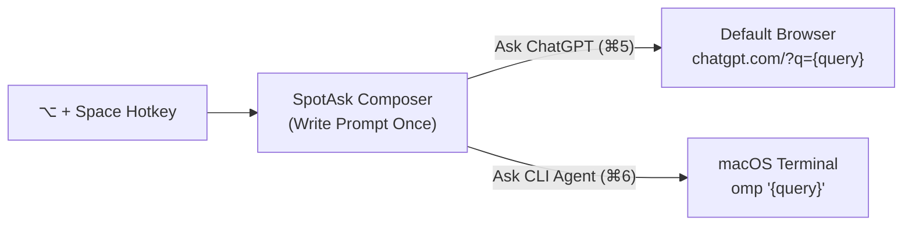

# Use ChatGPT and CLI agents from one Mac hotkey

*Ask first. Choose the destination after.*

You are in the middle of reading code or documentation when a question strikes. You know the question, but you do not want to break flow: opening a browser, finding an open tab, summoning a terminal, and copying and pasting prompts between windows interrupts your train of thought. 

SpotAsk turns that into a single motion. Press <kbd>⌥ + Space</kbd> (Option+Space) anywhere on macOS to bring up a focused floating composer. Type your question once while it is fresh, then choose its destination directly from the window: send conceptual questions to **ChatGPT** in your browser, or hand local repository tasks to a **CLI agent** running in Terminal.



Throughout this guide, we use two concrete read-only tasks to demonstrate the workflow:
1. **ChatGPT (concept explanation & comparison)**: `Explain when a small team should use Git rebase instead of merge. Give one concrete example.`
2. **CLI Agent (local repository inspection)**: `Inspect this repository's failing test. Explain the cause and propose a fix; do not edit files.`

---

## The 30-second workflow {#the-workflow-in-30-seconds}

Here is the entire loop from hotkey summon to execution:

1. **Summon over your work**: While reviewing code or docs in your editor, press <kbd>⌥ + Space</kbd>. The SpotAsk composer floats above your active window without shifting desktop Spaces or pulling other apps forward.
2. **Type the prompt**: Enter `Explain when a small team should use Git rebase instead of merge. Give one concrete example.`
3. **Dispatch to ChatGPT**: Click **Ask ChatGPT** or press its shortcut (e.g., <kbd>⌘ + 5</kbd>). Your macOS default browser immediately opens ChatGPT with the prompt filled in the composer. (Note: ChatGPT official web links pre-fill the query; you press Send or Return to submit).
4. **Dispatch to a CLI Agent**: Return to your project, press <kbd>⌥ + Space</kbd> again, and type `Inspect this repository's failing test. Explain the cause and propose a fix; do not edit files.` Click **OMP** (or press <kbd>⌘ + 6</kbd>). macOS Terminal opens and executes your local agent with the question safely passed as a shell argument.
5. **Dismiss cleanly**: Once dispatched, SpotAsk closes immediately. Press <kbd>Esc</kbd> at any point before sending to cancel and return to work.

### Visual demonstration

<video poster="/images/spotask-external-ask-hotkey-workflow-preview.png" src="/videos/spotask-external-ask-hotkey-workflow.mp4" controls muted playsinline width="720">
  <track kind="subtitles" src="/SpotAsk/videos/spotask-external-ask-hotkey-workflow.vtt" srclang="en" label="English" default>
</video>

*Video 1: The complete 30-second dual-destination workflow (30s) — summon once with ⌥Space, send a concept question to ChatGPT in the browser with pre-fill and manual send, then summon again to dispatch a local repository inspection into Terminal with OMP. [Download / Watch HD Video (1080p MP4)](/videos/spotask-external-ask-hotkey-workflow.mp4)*


*Figure 2: SpotAsk dispatching a question directly into a local CLI agent in Terminal.*

---

## Set up the two destinations {#set-up-the-two-destinations}

Setting up ChatGPT and a local CLI agent in SpotAsk takes under two minutes.

### Destination 1: Web ChatGPT

1. Open **Settings > External Ask** (or use the URL deep-link `spotask://settings/external-ask`).
2. Click **Add Channel** (`+`) or check the built-in **Ask ChatGPT** entry.
3. Configure the fields:
   - **Action Type**: `Web question`
   - **Name**: `Ask ChatGPT`
   - **URL Template**: `https://chatgpt.com/?q={query}`
4. Save the entry.

`{query}` is SpotAsk's template placeholder. When dispatched, SpotAsk percent-encodes your text according to RFC 3986 rules and passes it to your default browser. This requires an active web session in your browser.

::: tip Pre-fill vs Auto-submit in ChatGPT
Official `chatgpt.com/?q=` parameters **pre-fill** the web composer and wait for you to click Send or press Return. If you prefer ChatGPT to submit automatically upon opening, you can optionally install the third-party userscript [ChatGPT URL Prompt Auto Submit](https://greasyfork.org/en/scripts/592577-chatgpt-url-prompt-auto-submit). Without this userscript, manual sending is standard and expected.
:::

### Destination 2: Local CLI Agent (Terminal Command)

1. In **Settings > External Ask**, click **Add Channel** (`+`).
2. Select **Terminal command**.
3. Configure the fields:
   - **Action Type**: `Terminal command`
   - **Name**: `OMP` (or `Local CLI`)
   - **Command**: `omp {query}`
   - **Icon**: Select the Terminal icon.
4. Click **Save**.

### How SpotAsk safely passes prompts to your shell

When you trigger a terminal command, SpotAsk generates a temporary executable script (`spotask-<uuid>.command`) and launches it via `/usr/bin/open -a Terminal`. 

To prevent shell expansion and argument injection risks:
- SpotAsk's template builder wraps `{query}` in single quotes (`'...'`) and escapes internal single quotes as `'\''`.
- Spaces, newlines, `$`, backticks (`` ` ``), double quotes (`"`), and semicolons (`;`) are safely treated as literal text inside the single-quoted string.
- If your CLI expects flags before prompt text or if your prompt might begin with `--`, configure your command template with a separator (e.g., `omp -- {query}`; for other tools, check that CLI's official help or documentation for argument separators).

```text
# Example command generated by SpotAsk for task 2:
omp 'Inspect this repository'\''s failing test. Explain the cause and propose a fix; do not edit files.'
```

::: warning Shell PATH resolution
Terminal commands run in your default user login shell inside Terminal.app. Ensure the target CLI binary (such as `omp`) is installed in your shell `$PATH` (e.g. `/usr/local/bin`, `/opt/homebrew/bin`, or `~/.local/bin`). If a command cannot be found when launched from GUI environments, specify the full path in the command template (e.g., `/Users/yourname/.local/bin/omp {query}`).
:::

### Keyboard shortcuts

Enabled External Ask entries receive in-app shortcuts following your prompt shortcuts. For example, if you have three prompt presets enabled, your first two External Ask entries are assigned <kbd>⌘ + 5</kbd> and <kbd>⌘ + 6</kbd>. Your actual shortcut numbers depend on the order and number of active prompts; always refer to **Settings > Shortcuts** for your Mac's active key combinations.

---

## Ask once, then choose {#ask-once-then-choose}

SpotAsk gives you two ways to interact with external destinations depending on whether you type first or pick a target first:

1. **Type first, click to send immediately**:
   - Summon SpotAsk with <kbd>⌥ + Space</kbd>.
   - Type your question.
   - Click the destination button (e.g. **Ask ChatGPT**) or press its assigned shortcut (<kbd>⌘ + 5</kbd>).
   - SpotAsk immediately opens the target and closes the summon window. If opening fails (for example, if an invalid application URI is configured), the window stays open with your draft intact.

2. **Pick first, type and send (Pending Target Badge)**:
   - Summon SpotAsk with <kbd>⌥ + Space</kbd> when the composer is empty.
   - Click **OMP** or press <kbd>⌘ + 6</kbd>.
   - SpotAsk pins an **OMP** pending target badge above the composer, and the placeholder changes to `"Type a question for OMP…"`.
   - Type your prompt and press <kbd>Return</kbd> to dispatch.
   - To cancel, press <kbd>Esc</kbd>, clear the text, or click the `×` on the badge.

---

## Try it in under a minute {#try-it-in-under-a-minute}

Once you have added both channels, you can verify your dual-destination workflow with a safe, 60-second test run:

First, test web pre-fill. Press <kbd>⌥ + Space</kbd>, type `Explain when a small team should use Git rebase instead of merge. Give one concrete example.`, and press <kbd>⌘ + 5</kbd> (or click **Ask ChatGPT**). Confirm that your default browser brings up ChatGPT with your prompt ready in the composer, and that clicking Send produces the expected explanation.

Second, test terminal dispatch. Switch back to your terminal or editor workspace, press <kbd>⌥ + Space</kbd>, type `Inspect this repository's failing test. Explain the cause and propose a fix; do not edit files.`, and press <kbd>⌘ + 6</kbd> (or click **OMP**). Confirm that Terminal opens a new window, launches `omp`, passes your exact prompt safely without shell syntax errors, and begins inspecting the project.

Third, confirm dismissal and return. Notice that in both dispatches, SpotAsk's floating summon window dismisses the moment the destination is triggered, without leaving modal dialogs or background tasks running. If you ever change your mind before dispatching, pressing <kbd>Esc</kbd> cleanly dismisses the window and leaves your clipboard untouched.

---

## When this is not the right tool {#when-this-is-not-the-right-tool}

External Ask is designed for hand-offs. It is not the right choice in every scenario:

- **When you want answers directly in the floating window**: If you want instant streaming answers inside SpotAsk without switching apps, use [in-app BYOK with your own API key](/use-cases/byok-macos-ai) or connect a local model via Ollama.
- **When your browser session is logged out**: Web question links rely on active browser logins. SpotAsk does not store credentials, session cookies, or bypass login screens.
- **When the CLI is missing from `$PATH`**: If Terminal opens but reports `command not found`, verify your login shell configuration or insert the absolute binary path into the template.
- **When queries have file or image attachments**: Adding attachments automatically bypasses External Ask and Decision Routing, keeping the conversation inside SpotAsk to prevent leaking file contents to external URLs.
- **Subscription vs API Key distinction**: A ChatGPT Plus or Pro subscription covers web use on `chatgpt.com` and official apps; it does not provide API credits for in-app BYOK streaming. External Ask lets you leverage your web subscription for free, but it does not connect `chatgpt.com` to SpotAsk's internal conversation history.

---

## Action types reference {#action-types}

Every External Ask channel is one of three action types:

| Action Type | Template Pattern | Example | What happens |
| :--- | :--- | :--- | :--- |
| **Web question** | `https://.../?q={query}` | `https://chatgpt.com/?q={query}` | Opens default browser with percent-encoded query. |
| **Open an app** | `scheme://...?text={query}` | `quicknote://new?text={query}` | Triggers a macOS URL scheme handler. |
| **Terminal command** | `command {query}` | `omp {query}` | Writes a script and launches it in Terminal.app. |

Common web question endpoints:
- **Ask ChatGPT**: `https://chatgpt.com/?q={query}`
- **Ask Perplexity**: `https://www.perplexity.ai/search?q={query}`
- **Ask Grok**: `https://grok.com/?q={query}`

---

## Optional: Decision routing {#decision-routing}

Instead of manually clicking a button or pressing a specific shortcut, you can let an intent classification model decide where your question belongs.

When enabled in **Settings > External Ask**:
1. Type your question in the composer and press <kbd>Return</kbd>.
2. SpotAsk queries your configured decision service (such as System One `jev-1.13.0` or OpenAI Decisions `gpt-6-luna`).
3. An inline confirmation card appears above the composer showing the recommended destination (e.g. `Ask ChatGPT` or `OMP`) and confidence score. Press <kbd>Return</kbd> to confirm, <kbd>Tab</kbd> to cycle destinations, or <kbd>Esc</kbd> to cancel.

<video poster="/images/spotask-smart-routing-preview.gif" src="/videos/SpotAsk-smart-routing-v5.mp4" controls muted playsinline width="720"></video>

*Video 3: Decision routing demonstrated on real app footage (28s) — evaluates prompt intent and presents an inline confirmation card with one-click dispatch and Tab-to-switch capability. [Download / Watch HD Video (1080p MP4)](/videos/SpotAsk-smart-routing-v5.mp4)*

::: warning Network and privacy boundary
Decision Routing is an optional cloud service, not an on-device local classifier. When triggered, your prompt text and candidate channel names/descriptions are sent to your configured decision endpoint. Attachments automatically bypass decision routing. For detailed threshold tuning and API endpoint setup, see the [Decision Routing Guide](/guides/decision-routing).
:::

<SpotAskSettingsLink section="external-ask" />

---

## Common questions

**Does External Ask consume my SpotAsk model API tokens?**  
No. External Ask dispatches directly to the external website, application, or terminal process. It does not consume tokens from your configured SpotAsk chat providers, and questions are not stored in SpotAsk's conversation history. (Note: Optional Decision Routing contacts your configured decision endpoint when Return is pressed).

**Why are Claude and Gemini web links not built-in by default?**  
Only services that reliably pre-fill and accept URL query parameters are built-in. Claude opens with the prompt pre-filled but requires manual submission; Gemini does not reliably accept query parameters in its web URL. You can still add custom entries for any service in Settings.

**Can I send queries to other local CLI tools like Ollama or custom scripts?**  
Yes, provided the command is reachable in your login shell `$PATH` (or specified with its full path) and uses a verified argument template. For example, local models via `ollama run llama3.2 {query}` or a tested script like `/usr/local/bin/my-script.sh {query}` can be configured as custom Terminal command entries.

---

Related: [External Ask & Intent Routing Use Case](/use-cases/external-ask-routing) · [Decision Routing Guide](/guides/decision-routing) · [ChatGPT for Mac vs SpotAsk Quick Ask](/compare/chatgpt-mac) · [BYOK Native AI Client](/use-cases/byok-macos-ai) · [Getting Started](/getting-started) · [Troubleshooting](/troubleshooting) · [Settings & Shortcuts Reference](/reference)
