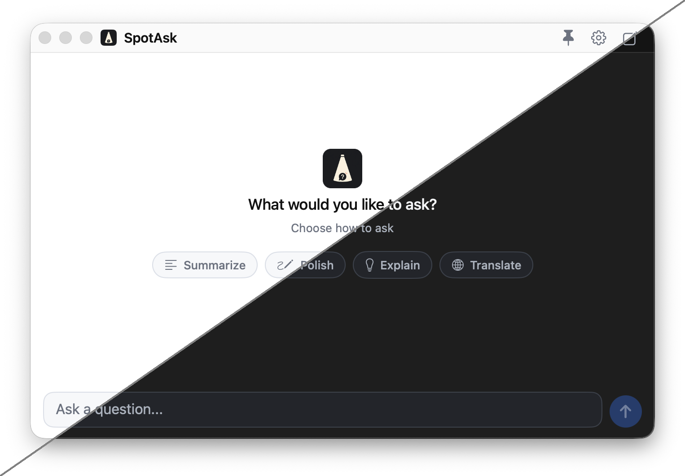

## What is SpotAsk

SpotAsk is a free, open-source Mac menu bar AI assistant for quick questions, built on a simple premise: **"Ask first. Decide where it goes after."**

Press one hotkey — `⌥ + Space` by default — and a focused question window appears instantly over whatever you are doing. Write the question while it is fresh, then choose:

- **In-app quick answers (BYOK)**: stream a reply in the window using your own API key and direct provider connection.
- **External Ask routing**: send the question to a web AI (ChatGPT, Perplexity, Grok), a desktop app, or a local CLI agent — in 1 click, or automatically with a decision model. See how to [reproduce the ChatGPT + CLI hotkey workflow](/guides/external-ask#the-workflow-in-30-seconds).
- **Selected-text actions**: highlight text in any macOS app to translate, explain, or summarize with the Selection Assistant (`⌥ + ⇧ + Space`).

Looking for [a free, open-source ChatGPT Mac alternative for quick questions](/compare/chatgpt-mac)? SpotAsk focuses on instant questions, selected-text lookups, and fast hand-offs rather than managing long workspace conversations.

No account, no telemetry, nothing between you and your provider. Press `Esc` and SpotAsk is gone.

## Free software, open source, and API costs

SpotAsk is free software licensed under the [GNU AGPL v3](https://github.com/shiquda/SpotAsk/blob/main/LICENSE) on [GitHub](https://github.com/shiquda/SpotAsk), with no app purchase fee, no account requirement, and no telemetry.

To stream in-window answers on <kbd>⌥ Space</kbd>, you connect your own provider API key ([BYOK](/use-cases/byok-macos-ai)) or a local endpoint like Ollama. Token usage is billed directly by your chosen provider according to their API pricing; consumer subscriptions like ChatGPT Plus or Claude Pro do not include developer API access. If you prefer not to configure an API key, [External Ask](/guides/external-ask) offers a separate workflow that routes your prompt to web AI or local CLI tools without spending API tokens.

SpotAsk focuses strictly on instant questions, selected-text lookups, and fast hand-offs. It is built as a focused menu bar companion rather than a local model runner, agent execution sandbox (shell, files, or MCP), document workspace, or complete system launcher. Teams managing persistent multi-threaded chats or project workspaces can keep those dedicated tools and pair them with SpotAsk for keyboard-first quick access.

*Figure: SpotAsk floating conversation window displaying on-the-fly model selection across configured BYOK providers.*
## Next steps

- [Getting Started](/getting-started) — install SpotAsk, connect a service, and ask your first question.
- [Explore SpotAsk](/explore) — the capability map for questions, selection, routing, models, attachments, prompts, and shortcuts.
- [Guides](/guides/connect-openai-compatible) — provider setup, then per-feature how-to pages and use cases.
- [Troubleshooting](/troubleshooting) — connection, model, permission, and shortcut problems.
