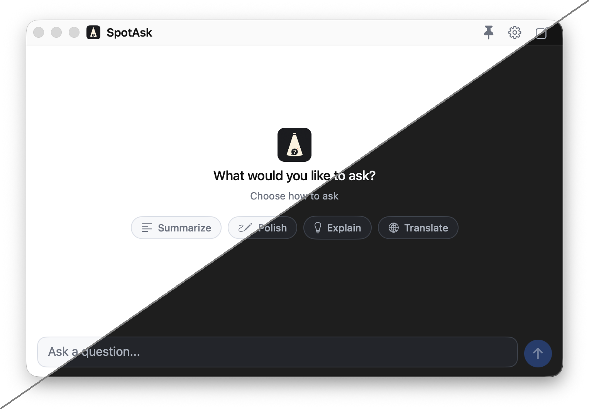

# BYOK Mac menu bar AI assistant for quick questions

SpotAsk is a free, open-source Mac menu bar AI assistant for quick questions, built on a Bring-Your-Own-Key (BYOK) architecture. It connects directly from your Mac to your own API keys or locally hosted models, with zero SpotAsk middleman servers in between.

If you already have API keys from OpenAI, Anthropic, or Google—or run local models like Ollama—SpotAsk gives you an instant hotkey (<kbd>⌥ Space</kbd>) to ask a quick question, act on selected text, and return to your flow. There are no SpotAsk accounts, no monthly software subscriptions, and no middleman markup: you pay only your provider for the tokens you actually consume.
## Core Capabilities

- **Multi-Provider & Protocol Support**: Native support for OpenAI-compatible endpoints, Anthropic Messages API, and Google Gemini REST API, switchable via the model picker in the composer.
- **Direct Communication & Local Credential Storage**: Requests are dispatched directly to provider endpoints without intermediate relay servers. API access keys are stored in a local credentials file restricted to the current user (`0600`); the current implementation does not use Keychain.
- **Local Offline Model Execution**: Built-in support for loopback services like Ollama or LM Studio, allowing full offline operation when traveling or disconnected.

## 3-Step Quick Start

1. **Open Services Settings**: Launch SpotAsk, press <kbd>⌘ + ,</kbd> to open Settings, and select the **Services** tab.
2. **Configure Provider & Key**: Click "Add Service", select your API format, enter your endpoint address, access key, and model ID, then click "Test Connection".
3. **Select Model & Ask**: Summon SpotAsk using your global hotkey, pick your configured service from the top model picker, and start asking.

## Visual Demo


*Figure 1: SpotAsk floating conversation window displaying on-the-fly model selection across configured BYOK providers.*

## Verified Boundaries & Practical Notes

- **Provider Account Required**: SpotAsk is a BYOK client and does not sell or distribute API credits. You supply your own API key from OpenAI, Anthropic, Google, or host a local model like Ollama.
  A ChatGPT Plus subscription is not an API key. You can [use your ChatGPT subscription through Ask ChatGPT instead](/guides/chatgpt-option-space#faq).
- **Billing & Quotas**: Compute costs are billed directly by your model provider based on your actual token usage; rate limits and concurrency limits are governed by your provider account tier.
- **Service Address Formatting**: OpenAI-compatible services distinguish between a Service Root (`https://api.openai.com/v1`) and a Full Request Address (`https://api.openai.com/v1/chat/completions`). See our documentation for endpoint conventions.

## When a full chat workspace is the better choice

SpotAsk is designed for instant questions, selected-text lookups, and fast hand-offs rather than long, multi-threaded project management. A full chat workspace is the better choice when:

- **You need persistent conversations and searchable history**: You want ongoing conversation threads organized into project folders, custom GPTs, or document workspaces.
- **You rely on account-managed features**: You need vendor-hosted memories, collaborative Canvas document editing, or native spoken voice modes (such as ChatGPT for Mac's Advanced Voice Mode).
- **You prefer a single predictable subscription**: You prefer paying a flat $20/month rather than funding developer API credits, monitoring token usage, and rotating API keys.
- **You need complex multi-window management**: You want dedicated multi-window chat organization and complex artifact panes.

SpotAsk complements these workspaces: keep your full chat workspace for deep sessions, and use SpotAsk on <kbd>⌥ Space</kbd> for quick answers, text selection, and routing. The same configured service can also [translate or rewrite selected text across Mac apps](/use-cases/selection-assistant) without copying passages into a separate browser window. You can [compare SpotAsk with ChatGPT for Mac](/compare/chatgpt-mac) to see how the two workflows differ in practice.

## Download SpotAsk

Download the latest DMG from [GitHub Releases](https://github.com/shiquda/SpotAsk/releases/latest) (Apple Silicon and Intel supported), or install via Homebrew:

```sh
brew tap shiquda/spotask https://github.com/shiquda/SpotAsk
brew install --cask shiquda/spotask/spotask
```

### Related Guides

- [Connect an OpenAI-Compatible Service](/guides/connect-openai-compatible) — Setup for OpenAI, DeepSeek, and Groq.
- [Global Selection Assistant Workflow](/use-cases/selection-assistant) — Translate and rewrite selected text across apps with your BYOK model.
- [Compare apps](/compare/) — other BYOK apps compared.
- [SpotAsk vs Raycast AI](/compare/raycast-ai) — BYOK in Raycast vs SpotAsk.
- [Connect Anthropic](/guides/connect-anthropic) — Claude API keys and streaming configuration.
- [Service Root vs Full Request Address](/guides/service-addresses) — Endpoint URL guidelines.
- [Zero-Telemetry Privacy Architecture](/use-cases/privacy-architecture) — Credential storage and data routing.
