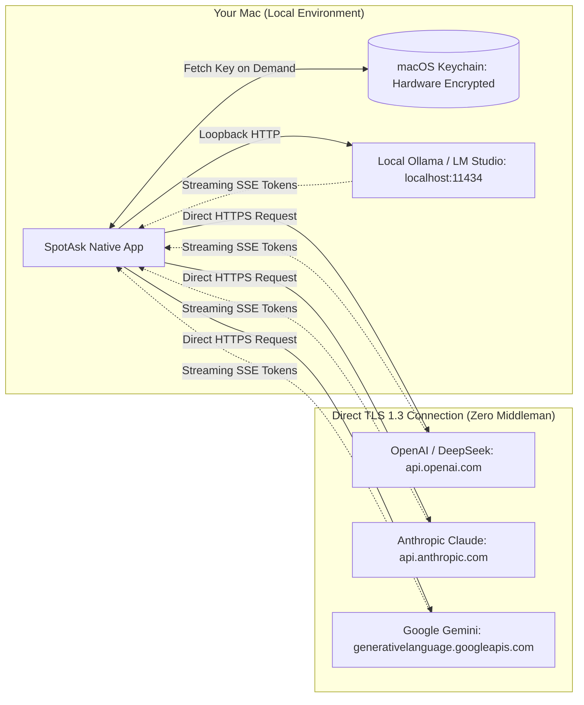

# BYOK Native macOS AI Client: Bring Your Own API Key with Zero Markup

SpotAsk is a native macOS AI assistant built on a true Bring-Your-Own-Key (BYOK) architecture. By connecting your own API keys directly to OpenAI, Anthropic, Google Gemini, DeepSeek, Groq, OpenRouter, or local offline LLMs via Ollama, SpotAsk lets you use the world's most capable models without paying monthly subscription premiums or routing prompts through proprietary cloud servers.

Your API keys stay encrypted inside the macOS system Keychain, and every request travels directly from your Mac to your configured provider.

## Quick Summary

- **Zero markup pricing**: Pay raw token costs directly to your AI provider (often just pennies per month for everyday queries) instead of paying $20–$30/month flat SaaS subscriptions.
- **Zero middleman servers**: All requests are dispatched directly from your Mac via TLS 1.3. SpotAsk operates no proxy servers, no user accounts, and zero cloud telemetry.
- **Hardware-encrypted Keychain storage**: API credentials are stored securely via macOS Keychain Services (`kSecClassGenericPassword`), protected by Apple Secure Enclave hardware encryption.
- **Multi-provider & model switching**: Configure multiple endpoints (OpenAI, Anthropic Claude, Gemini, DeepSeek, Ollama) and switch models on the fly with keyboard shortcuts (<kbd>⌘ + 1</kbd> ... <kbd>⌘ + 4</kbd>).
- **Offline local AI support**: Connect to local Ollama or LM Studio instances running on `localhost:11434` for 100% private, air-gapped query processing.

## Install SpotAsk

Download the latest DMG directly from [GitHub Releases](https://github.com/shiquda/SpotAsk/releases/latest):

- **Apple Silicon** (`arm64`): Download the `arm64` DMG for M-series Macs.
- **Intel Mac** (`x86_64`): Download the `x86_64` DMG for Intel Macs.

Official binaries are signed with an Apple Developer ID certificate and notarized by Apple (`macOS 15+ · Apple Silicon / Intel · Native Swift`).

Or install using Homebrew:

```sh
brew tap shiquda/spotask https://github.com/shiquda/SpotAsk
brew install --cask shiquda/spotask/spotask
```

## The Problem: The Commercial AI Wrapper Trap & Subscription Lock-In

Commercial AI desktop wrappers have proliferated, but their business models create significant downsides for users:

1. **The 3x–5x subscription markup trap**: Most third-party Mac AI apps charge $15 to $30 per month. If you make 30 quick requests a day using modern cost-effective models (such as GPT-4o-mini, Claude 3.5 Haiku, or DeepSeek-V3), raw API token costs total less than $0.50/month. SaaS wrappers force you to pay 30x–60x more than the actual compute cost.
2. **Centralized middleman cloud risks**: Proprietary wrapper apps typically route your prompts and API tokens through their own cloud servers. If their servers experience an outage, data breach, or unauthorized logging, your private conversations and intellectual property are compromised.
3. **Artificial rate limits & vendor lock-in**: Commercial platforms frequently restrict message frequency, limit token context windows, or lock you into one specific AI provider. You cannot easily switch between OpenAI, Anthropic, Google, and open-source models as frontier research evolves.
4. **Lack of local model compatibility**: SaaS tools rarely integrate with local, air-gapped LLMs running on your Mac's Apple Silicon neural engine.

## How SpotAsk Solves It: Direct TLS & Local Keychain Security

SpotAsk replaces the centralized SaaS proxy model with an open, client-side architectural paradigm.



### Architectural Principles

- **Direct Socket Connection**: Every request is initiated via native `URLSession` directly to the provider's domain. There is no `spotask.com/proxy` server. Network traffic is transparent and inspectable using tools like Proxyman, Wireshark, or Charles Proxy.
- **macOS Keychain Services Integration**: Keys are never written to unencrypted configuration files, plists, or local SQLite databases. SpotAsk queries the system Keychain (`kSecClassGenericPassword`) only when an API call is actively constructed.
- **Universal Provider Engine**: Supports:
  - **OpenAI-compatible**: OpenAI, DeepSeek, Groq, Mistral, Together, OpenRouter, vLLM, and Ollama.
  - **Anthropic Claude**: Claude 3.5 Sonnet, Claude 3.5 Haiku, and legacy models.
  - **Google Gemini**: Gemini 2.5 Flash, Gemini 1.5 Pro via native Google REST endpoints.
- **Air-Gapped Local LLM Compatibility**: Full support for `http://localhost:11434/v1` (Ollama) or `http://localhost:1234/v1` (LM Studio). When using local models, zero bytes leave your Mac.

## 3-Step Quick Start

### Step 1: Open Services Configuration

Launch SpotAsk, press <kbd>⌘ + ,</kbd> to open Settings, and click the **Services** tab (or run `open "spotask://settings/provider"`).

### Step 2: Configure Your Provider

1. Click **Add Service** or select an existing service template.
2. Select **API Format**: **OpenAI**, **Anthropic**, or **Gemini**.
3. Enter the service endpoint (e.g., `https://api.openai.com/v1` or `http://localhost:11434/v1`).
4. Enter your **Access Key** (stored in Keychain).
5. Specify your desired **Model ID** (e.g., `gpt-4o-mini`, `claude-3-5-haiku-20241022`, `deepseek-chat`, or `llama3.2`).
6. Click **Test Connection**. SpotAsk validates the handshake immediately.

### Step 3: Summon and Query with Raw Model Pricing

Press <kbd>⌥ + Space</kbd> to summon SpotAsk from anywhere. Select your model from the top picker or press <kbd>⌘ + 1</kbd> to <kbd>⌘ + 4</kbd>, type your query, and stream your answer.

## Visual Proof


*Figure 1: SpotAsk floating conversation window displaying on-the-fly model selection across configured BYOK providers.*

## Technical Specifications & Verified Boundaries

| Parameter | Specification | Verification Details |
| :--- | :--- | :--- |
| **Supported API Protocols** | OpenAI Chat Completions, Anthropic Messages API, Google Gemini REST API | Full support for Server-Sent Events (SSE) streaming and tool call payloads |
| **Key Storage** | macOS Keychain Services (`kSecClassGenericPassword`) | Hardware-backed encryption via Apple Secure Enclave; excluded from backups by default |
| **Transport Security** | TLS 1.3 HTTPS (`URLSession`) | Enforces modern cipher suites; accepts local loopback HTTP (`127.0.0.1` / `localhost`) for Ollama |
| **Local Model Support** | Ollama, LM Studio, vLLM, llama.cpp | Compatible with any OpenAI-compliant loopback endpoint |
| **Operating System** | macOS 15.0 or later | Universal binary (`arm64` Apple Silicon & `x86_64` Intel) |
| **Account Requirement** | None (Zero SpotAsk account required) | Direct client-to-provider architecture; no intermediate backend |

### Known Limitations & Boundaries

- **API Provider Account Required**: SpotAsk is a BYOK client and does not sell or distribute API credits. You must create an account with OpenAI, Anthropic, Google, or run a local model like Ollama.
- **Service Address Formatting**: OpenAI-compatible endpoints require either the Service Root (`https://api.openai.com/v1`) or the Full Request Address (`https://api.openai.com/v1/chat/completions`). See our [Service Addresses Guide](/guides/service-addresses) for detailed provider rules.
- **Provider Quotas and Rate Limits**: Rate limits, concurrency limits, and spend caps are enforced directly by your provider's API tier, not by SpotAsk.

## Download SpotAsk

Take control of your AI workflow with native BYOK performance.

Download the `arm64` or `x86_64` DMG from [GitHub Releases](https://github.com/shiquda/SpotAsk/releases/latest), or install with the [Homebrew commands above](#install-spotask).

### Explore Next

- [Connect an OpenAI-Compatible Service](/guides/connect-openai-compatible) — Step-by-step setup for OpenAI, DeepSeek, and Groq.
- [Connect Anthropic](/guides/connect-anthropic) — Configure Claude API keys and streaming.
- [Service Root vs Full Request Address](/guides/service-addresses) — Understand endpoint URL structures.
- [Zero-Telemetry Privacy Architecture](/use-cases/privacy-architecture) — How SpotAsk guarantees local-only data privacy.
