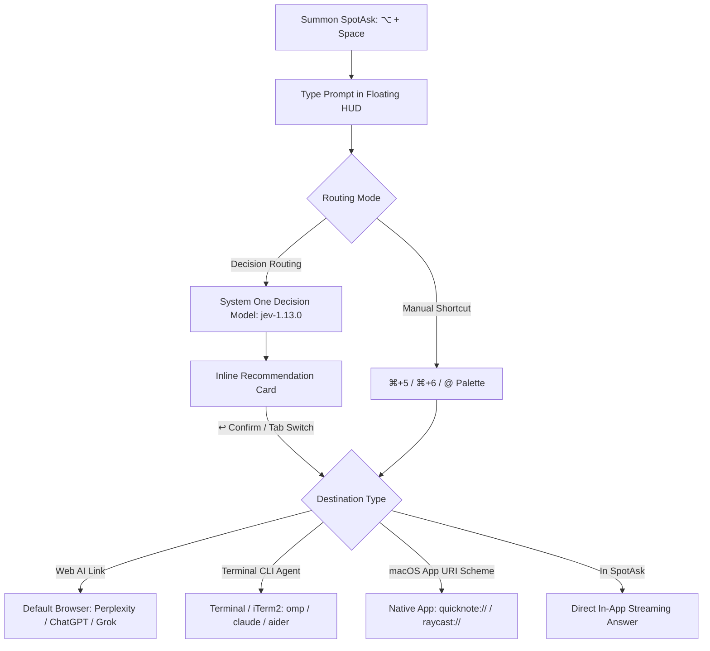

# External Ask & Intent Routing: From Instant Capture to Multi-Platform Execution

SpotAsk External Ask introduces a transformative interaction paradigm for modern AI workflows: **"Ask first. Decide where it goes after."**

Instead of forcing you to decide *where* to ask before typing your thought, SpotAsk lets you summon a clean floating window with a single global hotkey (<kbd>⌥ + Space</kbd>), write down your question while it is fresh, and then hand it off to the optimal execution environment—whether that is a web research engine (Perplexity, ChatGPT, Grok), a native desktop app, or a local terminal CLI agent (`omp`, `claude`, `aider`).

Routing can be performed with one click, a direct keyboard shortcut, or automatically via a lightweight System One decision model.

## Quick Summary

- **Decoupled capture and execution**: Capture fleeting ideas immediately without navigating browser tabs, opening terminal windows, or switching applications.
- **Dual-mode dispatch**:
  - **Manual 1-click & shortcuts**: Direct buttons and keys (<kbd>⌘ + 5</kbd>, <kbd>⌘ + 6</kbd>, `@` palette) route queries instantly.
  - **Automated Decision Routing**: A lightweight System One model (`typesafe/jev-1.13`) analyzes prompt intent and recommends the ideal channel with inline confirmation.
- **Three destination categories**:
  - **Web AI services**: e.g., Perplexity (`https://www.perplexity.ai/search?q={query}`) or ChatGPT.
  - **Local CLI agents**: e.g., `omp {query}`, `claude {query}`, or custom shell scripts.
  - **Native macOS apps**: e.g., `quicknote://new?text={query}` or `cursor://`.
- **Zero token waste**: Routed queries do not consume chat completion tokens or pollute in-app conversation history.
- **Strict privacy boundaries**: Remote decision requests require HTTPS; cross-origin redirects are blocked; attachments automatically bypass routing and remain in-app.

## Install SpotAsk

Download the latest DMG directly from [GitHub Releases](https://github.com/shiquda/SpotAsk/releases/latest):

- **Apple Silicon** (`arm64`): Download the `arm64` DMG for M-series Macs.
- **Intel Mac** (`x86_64`): Download the `x86_64` DMG for Intel Macs.

Official binaries are signed with an Apple Developer ID certificate and notarized by Apple (`macOS 15+ · Apple Silicon / Intel · Native Swift`).

Or install using Homebrew:

```sh
brew tap shiquda/spotask https://github.com/shiquda/SpotAsk
brew install --cask shiquda/spotask/spotask
```

## The Problem: The Mental Overhead of Multi-Tool AI Workflows

Today, no single AI tool excels at every task:

1. **The fragmentation of specialized tools**:
   - Quick factual questions and grammar checks are ideal for fast in-app models.
   - Current events and live market queries demand web research engines like Perplexity or Grok.
   - Code refactoring, test execution, and git operations require interactive CLI agents running in the terminal (`omp`, `claude-code`, `aider`).
2. **Cognitive friction at capture time**: When an urgent idea strikes, deciding *which* platform to open introduces hesitation. By the time you switch desktop spaces, launch your browser, wait for web apps to hydrate, and find the input box, your train of thought is interrupted.
3. **Repetitive copy-pasting**: Copying prompts between terminal windows, browser tabs, and desktop editors wastes minutes every day and clutters your clipboard.

## How SpotAsk Solves It: Unified Capture & Dual-Mode Routing

SpotAsk unifies prompt capture into a single keyboard-driven interface, then routes the prompt to where it executes best.



### Key Architectural Capabilities

- **1-Click Manual Routing**: Pre-configured buttons appear beneath the prompt presets in the question window. You can also trigger them via `@` search or sequential keyboard shortcuts.
- **Intelligent Decision Routing**: When enabled in **Settings > External Ask**, SpotAsk queries a fast System One decision endpoint (such as `https://api.typesafe.ai` or OpenRouter's `typesafe/jev-1.13`). In ~300&nbsp;ms, an inline confirmation card appears above the composer showing the suggested destination. Press <kbd>↩</kbd> to accept, <kbd>Tab</kbd> to cycle through other channels, or <kbd>⎋</kbd> to keep the query in SpotAsk.
- **Per-Conversation Toolbar Control**: An optional smart-routing toggle in the chat toolbar (<kbd>⌘ + ⇧ + R</kbd>) lets you pause automatic routing for the current session without altering global settings.
- **Attachment Privacy Bypass**: If you attach images, PDFs, or code files, SpotAsk automatically bypasses External Ask and Decision Routing, ensuring sensitive files remain inside the local chat interface.

## 3-Step Quick Start

### Step 1: Open Settings > External Ask

Press <kbd>⌘ + ,</kbd> in SpotAsk and navigate to **External Ask** (or run `open "spotask://settings/external-ask"`).

### Step 2: Configure Channels and Routing

1. Review built-in channels (ChatGPT, Perplexity) or click **New** to add your own:
   - **Web question**: `https://www.perplexity.ai/search?q={query}`
   - **Terminal command**: `omp {query}` or `claude {query}`
   - **Open an app**: `quicknote://new?text={query}`
2. (Optional) Under **Decision Routing**, check **Enable automatic routing**, enter your decision service address (`https://api.typesafe.ai`), select model `typesafe/jev-1.13`, and enter your access key.

### Step 3: Summon, Type, and Route

1. Press <kbd>⌥ + Space</kbd> over any application.
2. Type your question (e.g., *"Latest developments in quantum computing this week"* or *"Refactor this Swift struct to use actors"*).
3. Press <kbd>⌘ + 5</kbd> to send directly to Perplexity, or let Decision Routing suggest the target and press <kbd>↩</kbd>.

## Visual Proof

<video src="/videos/SpotAsk-smart-routing-v5.mp4" controls muted playsinline width="720"></video>

*Video: one question, three destinations — decision routing on real app footage (28s).*


*Figure 1: Decision routing evaluates prompt intent and presents an inline confirmation card with one-click dispatch and Tab-to-switch capability.*


*Figure 2: SpotAsk dispatching a question directly into a local CLI agent in Terminal.*

## Technical Specifications & Verified Boundaries

| Parameter | Specification | Details |
| :--- | :--- | :--- |
| **Supported Destination Types** | Web URLs, macOS URI schemes, Terminal shell commands, In-SpotAsk | Uses `{query}` placeholder with automatic URL percent-encoding or shell escaping |
| **Decision Models** | `typesafe/jev-1.13`, OpenRouter System One | Sub-second classification latency (~200–400&nbsp;ms) |
| **Transport Security** | TLS 1.3 HTTPS strictly enforced | Loopback HTTP allowed only for `localhost` / `127.0.0.1` debugging; redirects to non-origin or HTTP are blocked |
| **Shell Execution** | User default login shell (`$SHELL`) | Terminal actions launch in the default macOS Terminal or configured terminal emulator |
| **Timeout Handling** | Configurable from 0.5s to 5.0s (default 2.0s) | Gracefully falls back to manual channel selection or in-app answer upon network timeout |
| **Operating System** | macOS 15.0 or later | Universal binary (`arm64` & `x86_64`) |

### Known Limitations & Boundaries

- **Browser Login State**: Web questions open in your default browser; full generation requires an active logged-in session on the target platform (such as ChatGPT, Perplexity, or Grok).
- **Terminal CLI Dependencies**: Terminal commands execute within your user shell; target command binaries (such as `omp`, `ollama`, or `claude`) must reside in your shell `$PATH`.
- **Pre-fill vs Auto-Submit**: Web links pre-fill the search box on the destination website. Instant automatic submission depends on whether the third-party service supports URL-based submission (or a browser userscript).

## Download SpotAsk

Upgrade your Mac workflow with intelligent multi-platform routing.

Download the `arm64` or `x86_64` DMG from [GitHub Releases](https://github.com/shiquda/SpotAsk/releases/latest), or install with the [Homebrew commands above](#install-spotask).

### Explore Next

- [External Ask Comprehensive Guide](/guides/external-ask) — Advanced configuration, decision routing tuning, and userscripts.
- [macOS AI Launcher](/use-cases/mac-ai-launcher) — Instant global hotkey summoning.
- [BYOK Native AI Client](/use-cases/byok-macos-ai) — Connect your own API keys.
- [Global Selection Assistant](/use-cases/selection-assistant) — In-place text translation, polishing, and explanation.
