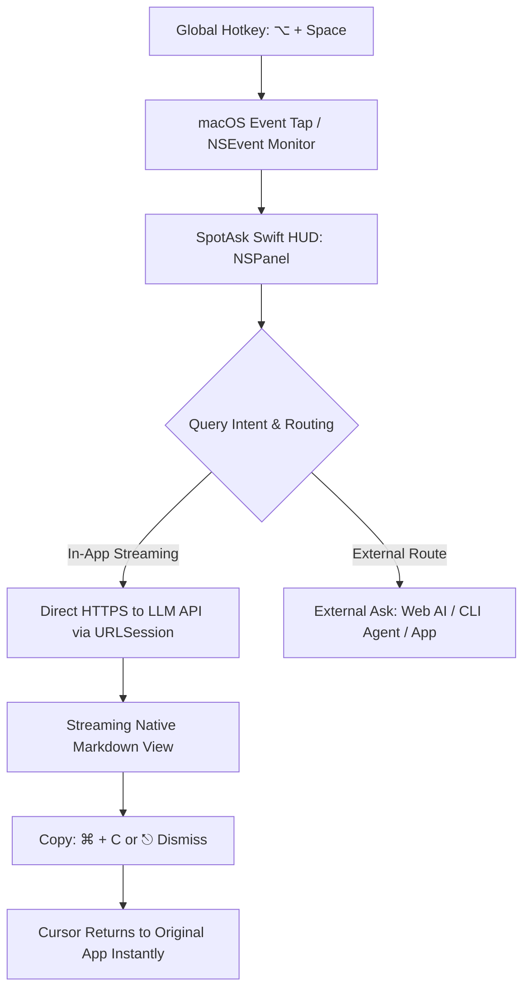

# macOS AI Launcher: Native, Instant Global Hotkey AI Assistant

SpotAsk delivers a friction-free macOS AI launcher designed around a single core interaction: press a global keyboard shortcut (<kbd>⌥ + Space</kbd> by default), ask your question in a floating HUD window, stream the response in real time, and press <kbd>⎋</kbd> to immediately dismiss it and return to your work.

Built with pure Swift and AppKit, SpotAsk eliminates the 500&nbsp;MB+ RAM footprint and sluggish cold-launch latency typical of Electron-based AI wrappers.

## Quick Summary

- **Instant hotkey summoning**: A global hotkey (<kbd>⌥ + Space</kbd>) brings up a focused question window instantly over any active application.
- **Pure native Swift & AppKit**: Under 10&nbsp;MB disk footprint, zero Electron or Chromium dependencies, and less than 30&nbsp;MB idle memory.
- **Done and gone (<kbd>⎋</kbd>)**: Press Escape to dismiss the window instantly—no residual tabs, no inbox badges, and zero workspace distraction.
- **Menu-bar resident**: Runs quietly in the macOS menu bar without cluttering your Dock.
- **Open source & free**: AGPL-3.0 licensed with zero monthly software fees.

## Install SpotAsk

Install in seconds using Homebrew:

```sh
brew tap shiquda/spotask https://github.com/shiquda/SpotAsk
brew install --cask shiquda/spotask/spotask
```

Or download the universal installer directly from [GitHub Releases](https://github.com/shiquda/SpotAsk/releases/latest):

- **Apple Silicon** (`arm64`): Download `SpotAsk-arm64.dmg`.
- **Intel Mac** (`x86_64`): Download `SpotAsk-x86_64.dmg`.

Official binaries are signed with an Apple Developer ID certificate and notarized by Apple.

## The Problem: Why Heavy AI Launchers and Web Tabs Fail

Most developers and knowledge workers ask dozens of quick questions daily: translating a phrase, checking a syntax detail, generating a shell command, or summarizing an error log. Traditional workflows create high cognitive friction:

1. **Context switching to browser tabs**: Opening ChatGPT or Claude in a browser requires switching desktop spaces, waiting for heavy web single-page apps to load, navigating tab sprawl, and manually copy-pasting the result back into your editor or terminal.
2. **The Electron bloat trap**: Desktop AI wrappers frequently package entire Chromium and Node.js runtimes. They consume 400–800&nbsp;MB of RAM at idle, cause noticeable launch lag, drain laptop battery life, and clutter the macOS Dock with persistent windows.
3. **The recurring subscription barrier**: Many third-party AI launchers charge $15–$30/month just for shortcut summoning and proxy your prompts through proprietary cloud servers, adding latency and privacy risks.
4. **Window management friction**: Conventional multi-window apps demand manual window repositioning, minimization, or closing, interrupting keyboard-focused flow.

## How SpotAsk Solves It: Pure Native macOS Architecture

SpotAsk treats AI assistance as an ephemeral, Spotlight-like utility rather than a persistent destination.



### Architectural Highlights

- **Menu Bar Accessory Mode (`LSUIElement = 1`)**: SpotAsk runs as an accessory application without a Dock icon. It stays resident in memory with near-zero resource consumption until summoned.
- **Floating `NSPanel` Level**: The question window uses a native AppKit `NSPanel` configured at `.floating` window level. It floats cleanly above fullscreen IDEs, Xcode, browsers, and Stage Manager workspaces without stealing window focus from your background task.
- **Asynchronous Swift Concurrency & Streaming**: Powered by modern Swift `async`/`await` and `URLSession` server-sent events (SSE). Token streaming begins within milliseconds of your query.
- **Keyboard-First dismissed state**: Hitting <kbd>⎋</kbd> closes the window and immediately restores key focus to the application you were using before summoning SpotAsk.

## 3-Step Quick Start

### Step 1: Launch and Configure Hotkey

Open SpotAsk. It appears as an icon in your menu bar. The default summoning hotkey is <kbd>⌥ + Space</kbd>.

To customize the hotkey, open Settings (<kbd>⌘ + ,</kbd>) > **Shortcuts**, click the shortcut recorder, and press your preferred key combination (e.g., <kbd>⌥ + A</kbd> or <kbd>⌃ + Space</kbd>).

### Step 2: Connect Your Model Endpoint

Navigate to **Settings > Services**. SpotAsk supports OpenAI, Anthropic, Gemini, DeepSeek, and local Ollama endpoints. Enter your API key and model ID, then click **Test Connection**. Your keys are encrypted locally in the macOS Keychain.

### Step 3: Summon, Ask, and Dismiss

1. Press <kbd>⌥ + Space</kbd> over any application (Xcode, Safari, Terminal, Notes).
2. Type your question and press <kbd>↩</kbd>.
3. Stream the answer, click **Copy** or press <kbd>⌘ + C</kbd>, and press <kbd>⎋</kbd> to return to your work.

## Visual Proof


*Figure 1: SpotAsk responds instantly to global hotkey summoning over any active macOS application, streaming markdown answers with instant Esc dismissal.*

## Technical Specifications & Verified Boundaries

| Parameter | Specification | Verification Evidence |
| :--- | :--- | :--- |
| **Minimum OS** | macOS 15.0 (Sequoia) or later | Verified on macOS 15.0+ Apple Silicon & Intel |
| **Architectures** | Universal 2 (`arm64` & `x86_64`) | Mach-O universal binary; native execution on M1/M2/M3/M4 and Intel Macs |
| **Installer Size** | ~10&nbsp;MB DMG package | Pure Swift & AppKit binary; zero Electron or Node.js runtime |
| **Idle Memory** | < 30&nbsp;MB RSS | Measured via macOS Activity Monitor and Instruments |
| **Window Class** | Native AppKit `NSPanel` | Configured with `.nonactivatingPanel` and `.floating` window level |
| **Code Signing** | Apple Developer ID Application | Hardened Runtime enabled and Apple notarized (`spctl --assess` pass) |
| **Software License** | GNU AGPL-3.0 | 100% open-source on GitHub; zero commercial lock-in |

### Known Limitations & Boundaries

- **macOS System Requirement**: SpotAsk requires macOS 15.0 or later to leverage modern AppKit and Swift concurrency APIs. Earlier macOS versions (macOS 14 Sonoma or older) are not supported.
- **Hotkey Conflicts**: If another utility (such as Alfred, Raycast, or system Input Method shortcuts) reserves <kbd>⌥ + Space</kbd>, SpotAsk alerts you and allows setting an alternative combination in Settings > Shortcuts.
- **Secure Input Mode**: In password fields or secure terminal prompts where macOS enables Secure Input, global key capture may be temporarily suspended by the operating system for security.

## Download SpotAsk

Get started with the fastest native macOS AI launcher today:

```sh
brew tap shiquda/spotask https://github.com/shiquda/SpotAsk
brew install --cask shiquda/spotask/spotask
```

Direct installer packages are available on [GitHub Releases](https://github.com/shiquda/SpotAsk/releases/latest).

### Explore Next

- [BYOK Native macOS AI Client](/use-cases/byok-macos-ai) — Bring your own API key with zero markup.
- [External Ask & Intent Routing](/use-cases/external-ask-routing) — Route queries to web AI or local CLI agents.
- [Global Selection Assistant](/use-cases/selection-assistant) — Translate, polish, or summarize selected text across apps.
- [Spotlight, Siri & Shortcuts Guide](/guides/macos-integration) — Deep integration with native macOS automation.
