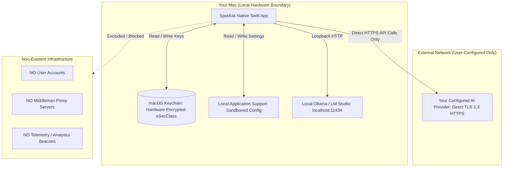

# Zero-Telemetry Privacy Architecture: Local-First, No Accounts, No Middleman Servers

SpotAsk is engineered from the ground up on a local-first, zero-telemetry privacy model. There are no user accounts, no passwords, no licensing servers, and no central proxy backends.

Your API credentials are encrypted locally in the macOS system Keychain, your prompts are dispatched directly from your Mac to your chosen AI provider via TLS 1.3, and zero tracking SDKs or behavioral beacons are embedded in the application.

The complete codebase is open-source under GNU AGPL-3.0 for independent public audit.

## Quick Summary

- **100% account-free**: No registration, no email verification, and no user tracking. Download, launch, and use immediately.
- **Zero middleman proxy servers**: Network requests travel directly from your Mac to the configured provider API (OpenAI, Anthropic, Gemini, or local Ollama). SpotAsk operates zero intermediate relay servers.
- **Hardware-encrypted Keychain storage**: API keys are saved exclusively in macOS Keychain Services (`kSecClassGenericPassword`), protected by Apple Secure Enclave encryption.
- **Zero in-app analytics or telemetry**: The app contains no third-party tracking libraries (no Mixpanel, PostHog, Google Analytics, or Sentry).
- **1-click local data wipe**: Clear all stored credentials, settings, and cached conversation history instantly with one click in Settings > General.
- **Open-source AGPL-3.0 license**: Every line of Swift networking and storage code is publicly auditable on GitHub.

## Install SpotAsk

Download the latest DMG directly from [GitHub Releases](https://github.com/shiquda/SpotAsk/releases/latest):

- **Apple Silicon** (`arm64`): Download the `arm64` DMG for M-series Macs.
- **Intel Mac** (`x86_64`): Download the `x86_64` DMG for Intel Macs.

Official binaries are signed with an Apple Developer ID certificate and notarized by Apple (`macOS 15+ · Apple Silicon / Intel · Native Swift`).

Or install using Homebrew:

```sh
brew tap shiquda/spotask https://github.com/shiquda/SpotAsk
brew install --cask shiquda/spotask/spotask
```

## The Problem: The Privacy Crisis in Commercial AI Tools

Most commercial desktop AI wrappers compromise user privacy through opaque cloud architectures:

1. **Invisible telemetry & behavioral fingerprinting**: Many desktop AI tools embed commercial analytics SDKs that silently log every prompt length, model used, feature clicked, system hardware UUID, and IP address. This behavioral telemetry is uploaded to third-party data brokers.
2. **Mandatory account creation & profiling**: Closed-source tools require users to register an account with email, phone number, and payment credentials before launching the app, linking private queries directly to real-world identities.
3. **Middleman proxy interception**: Proprietary wrapper clients route your prompts and confidential business documents through their own centralized cloud servers before forwarding them to OpenAI or Anthropic. If the wrapper company suffers an internal leak, misconfiguration, or legal subpoena, your private data is exposed.
4. **Opaque closed-source binaries**: Proprietary software cannot be independently audited. You have no way to verify whether your keystrokes, clipboard contents, or background files are being monitored.

## How SpotAsk Solves It: Verifiable Local-First Architecture

SpotAsk guarantees verifiable privacy by eliminating central servers from the product architecture entirely.



### Architectural Privacy Guarantees

- **No User Accounts**: SpotAsk contains no login screen, no user database, and no session cookies. The app runs autonomously on your Mac.
- **Direct Sockets to Configured Endpoints**: SpotAsk establishes direct TLS 1.3 HTTPS connections to `api.openai.com`, `api.anthropic.com`, `generativelanguage.googleapis.com`, or any custom endpoint you configure. No traffic passes through a SpotAsk server.
- **macOS Keychain Encryption**: Access keys are stored in the system Keychain (`kSecClassGenericPassword`). They are decrypted in memory only when assembling an active HTTP request and are never written to plain-text configuration files.
- **Local Application Support Storage**: Settings, custom prompts, and conversation histories (when conversation retention is enabled) are stored locally in `~/Library/Application Support/SpotAsk/`. They never leave your machine.
- **Zero In-App Analytics**: The binary includes no tracking code, advertising identifiers, or telemetry daemons. Network monitoring tools (Proxyman, Wireshark, Little Snitch) confirm that SpotAsk initiates network calls only to your explicitly configured AI endpoints.
- **Total Local Data Purge**: In **Settings > General**, clicking **Clear All Local Data** permanently deletes all access keys from the Keychain, wipes local settings, and purges all conversation history.

## 3-Step Quick Start: Verify and Run Privately

### Step 1: Install and Audit Network Traffic

Install SpotAsk via Homebrew or GitHub Releases. Open a network monitor like Proxyman or Little Snitch—you will observe zero background telemetry connections.

### Step 2: Configure Your API Key or Local LLM

Open Settings (<kbd>⌘ + ,</kbd>) > **Services**:
- Enter your direct API key (stored in the system Keychain).
- Or enter `http://localhost:11434/v1` to connect to local Ollama for 100% offline, air-gapped execution where zero data touches the internet.

### Step 3: Query with Absolute Privacy

Summon SpotAsk with <kbd>⌥ + Space</kbd> or highlight text across any app to process queries knowing that your data remains strictly between you and your chosen model provider.

## Technical Specifications & Verified Boundaries

| Parameter | Specification | Verification Details |
| :--- | :--- | :--- |
| **User Account System** | None | Zero registration, login, or user tracking |
| **Middleman Proxy** | None | Direct client-to-endpoint network architecture |
| **In-App Telemetry** | 0 bytes | Zero analytics SDKs or tracking beacons in binary |
| **Credential Storage** | macOS Keychain Services (`kSecClassGenericPassword`) | Hardware-backed encryption via Apple Secure Enclave |
| **Local Config Path** | `~/Library/Application Support/SpotAsk/` | Sandboxed local application directory |
| **Source Code License** | GNU AGPL-3.0 | 100% open-source and auditable on GitHub |
| **Software Verification** | Apple Developer ID Notarized | Hardened Runtime enabled; passed Apple gatekeeper scan |

### Known Limitations & Boundaries

- **Third-Party Provider Policies**: While SpotAsk does not log or intermediate your requests, the API provider you configure (e.g., OpenAI, Anthropic, or Google) handles your prompts according to their published data-retention policies. For complete data isolation, connect SpotAsk to local offline Ollama models.
- **Decision Routing Service Boundary**: When automated Decision Routing is enabled in External Ask, the prompt text and channel candidate descriptions are sent over HTTPS to your configured decision service (such as TypeSafe or OpenRouter) to determine the best destination. Decision requests strictly require HTTPS and reject non-origin redirects.
- **Update Checking**: Automatic update checking checks the official GitHub Release API once at launch. It transmits zero prompt contents, keys, or telemetry. It can be completely disabled in Settings > About > Updates.

## Download SpotAsk

Experience private, local-first macOS AI without compromise.

Download the `arm64` or `x86_64` DMG from [GitHub Releases](https://github.com/shiquda/SpotAsk/releases/latest), or install with the [Homebrew commands above](#install-spotask).

### Explore Next

- [Privacy & Local Data Official Policy](/privacy) — Detailed breakdown of local storage locations and diagnostics.
- [BYOK Native AI Client](/use-cases/byok-macos-ai) — Bring your own API keys with zero markup.
- [macOS AI Launcher](/use-cases/mac-ai-launcher) — Instant global hotkey summoning.
- [Explore SpotAsk](/explore) — Complete capability map for native macOS AI workflows.
