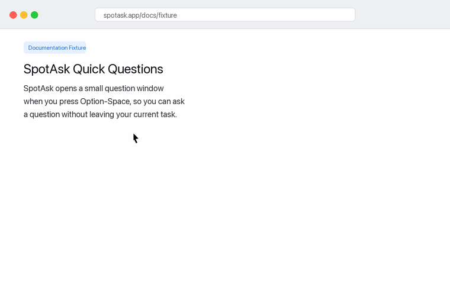
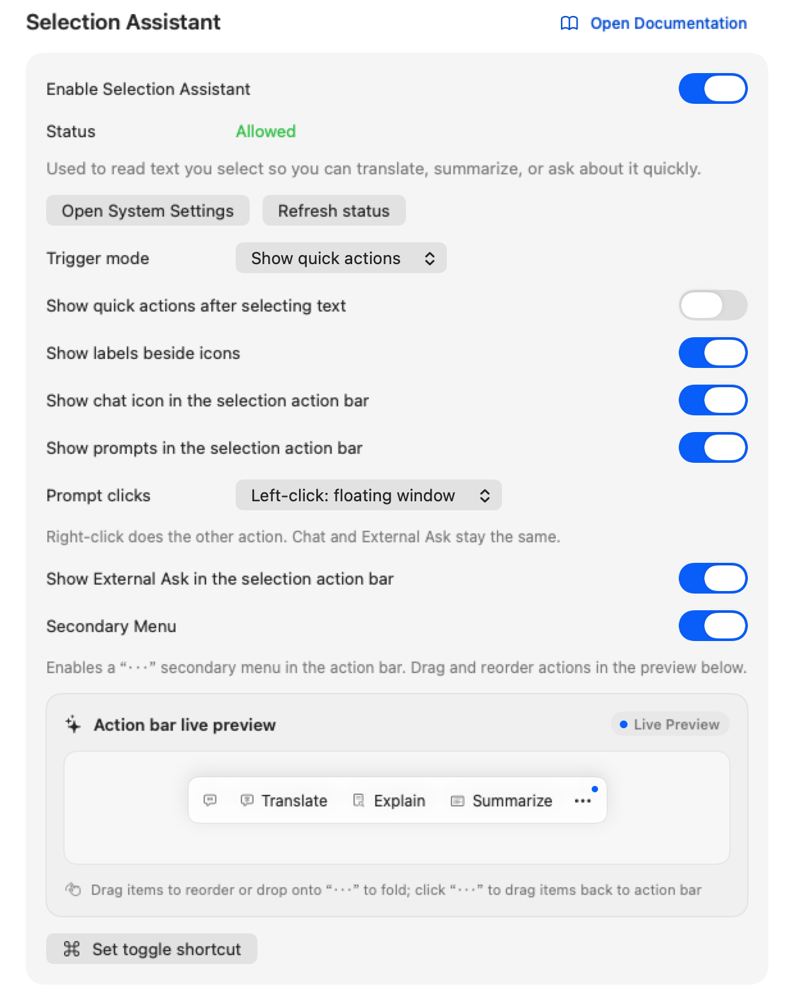
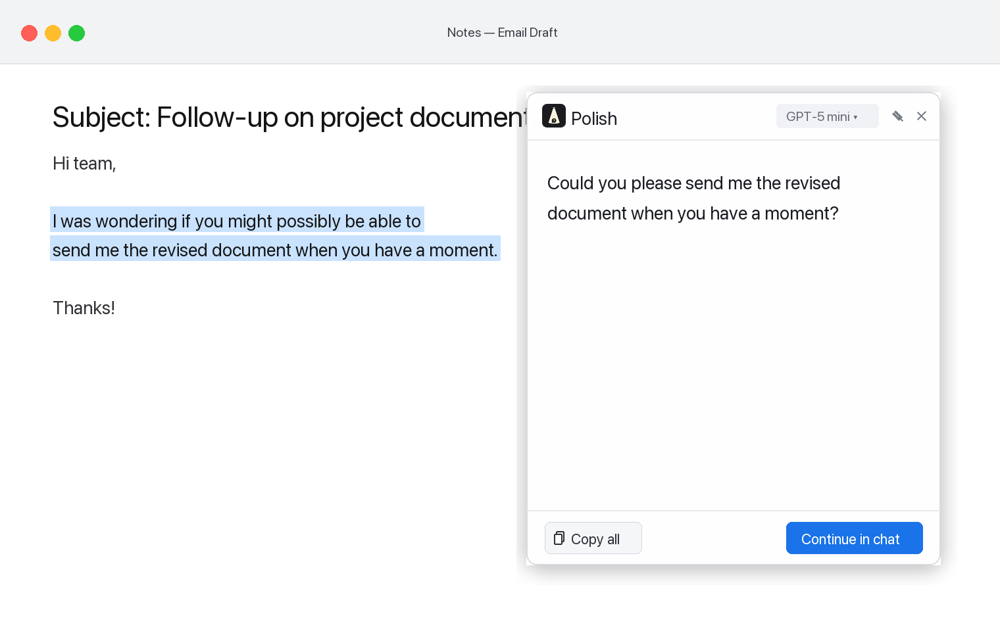

# Translate or rewrite selected text without leaving your Mac app

Select a passage, choose an action, and keep working.

When reading research papers in Safari, skimming PDFs in Preview, or drafting an email in Mail, switching windows to copy-paste text into a web translator or chat window breaks your focus. SpotAsk's Selection Assistant brings AI-powered translation and rewriting directly to the active application.

> **Availability across apps**: The word "anywhere" refers to macOS applications that expose selected text through native macOS Accessibility APIs—such as Safari, Apple Notes, Mail, Xcode, and Terminal. Applications with custom rendering (such as certain PDF readers) require clipboard-assisted fallback, while password fields and secure prompts are intentionally inaccessible.

---

## The selection-to-translation demo

Here is a typical workflow in Safari: you encounter a sentence with product terminology and shortcut descriptions, highlight it, and translate it in place.


*Figure 1: Highlighting a sentence in Safari reveals the inline action bar. Clicking Translate opens an adjacent floating window with the translation, leaving the original text clearly visible.*

### Input and output comparison

| Stage | Content | Notes |
| :--- | :--- | :--- |
| **Input (Safari)** | `SpotAsk opens a small question window when you press Option-Space, so you can ask a question without leaving your current task.` | A human-authored product description with hotkey formatting and terminology. |
| **Action** | Left-click **Translate** on the inline action bar (or press `⌥ + ⇧ + Space`). | Dispatches the selection directly to your configured BYOK model. |
| **Output (Floating Window)** | `当您按下 Option-Space 时，SpotAsk 会打开一个小提问窗口，因此您无需离开当前任务即可提出问题。` | Preserves the proper noun `SpotAsk` and shortcut notation `Option-Space` accurately. |
| **Next Step** | Click **Copy all** (`⌘ + C`) or **Continue in chat**. | The answer is placed on your clipboard; your working window remains active. |

---

## Try the same translation

You can reproduce this exact translation workflow on your Mac in a few steps.

### Prerequisites

1. **macOS 15.0 (Sequoia) or later** on an Apple Silicon or Intel Mac.
2. **SpotAsk installed** via [GitHub Releases](https://github.com/shiquda/SpotAsk/releases/latest) or Homebrew (`brew tap shiquda/spotask https://github.com/shiquda/SpotAsk && brew install --cask shiquda/spotask/spotask`).
3. **One AI service configured**: SpotAsk requires an active model endpoint to process queries. Follow the [BYOK native AI client setup](/use-cases/byok-macos-ai) or [OpenAI-compatible provider guide](/guides/connect-openai-compatible) to add your API key.

### Setup and execution

1. **Enable the assistant**: Open **Settings (`⌘ + ,`) > Selection Assistant**, and toggle on **Enable Selection Assistant**.
2. **Grant Accessibility permission**: When prompted by macOS, open **System Settings > Privacy & Security > Accessibility** and ensure **SpotAsk** is enabled. SpotAsk uses this permission solely to read highlighted text coordinates; it never monitors your entire screen or keystrokes.
3. **Choose your trigger mode**:
   - **Show quick actions** (recommended): Displays the floating action bar next to your selection. You can set the auto-show delay (default: 0.8 seconds) or rely on the manual shortcut (`⌥ + ⇧ + Space`).
   - **Run default action**: Immediately triggers your preferred preset (such as Translate) upon selection.
4. **Trigger translation**: Highlight the sample sentence above in your browser. When the action bar appears, click **Translate**. A floating answer panel opens adjacent to your selection without covering the source text.
5. **Copy the result**: Click **Copy all** (or press `⌘ + C` while the floating panel is focused) to copy the translated text to your clipboard.


*Figure 2: Settings > Selection Assistant lets you toggle auto-display, configure prompt click behavior, and customize action bar ordering.*

---

## Rewrite a draft: copy versus in-place replacement

Reading and writing have fundamentally different context requirements: a read-only article cannot be edited in place, whereas a draft in a composer often benefits from direct revision. SpotAsk differentiates between these contexts.

### Practical scenario in Apple Notes or Mail

Suppose you are drafting an email and want to polish a wordy sentence:

- **Original draft**: `I was wondering if you might possibly be able to send me the revised document when you have a moment.`
- **Action**: Highlight the sentence in Notes or Mail, then click **Polish**.
- **Refined output**: `Could you please send me the revised document when you have a moment?`


*Figure 3: Polishing a draft sentence in Apple Notes. The floating window presents the refined version, ready to copy or continue.*

### How output delivery works in editable versus read-only views

| View Type | Applications | Available Actions | Workflow Details |
| :--- | :--- | :--- | :--- |
| **Read-Only Views** | Safari, Chrome, Preview (PDF), Xcode documentation | **Floating Window + Copy All** | Text nodes cannot be modified via Accessibility. SpotAsk displays the answer in an unpinned or pinned floating window. Press `⌘ + C` or click **Copy all** to copy. |
| **Editable Drafts (Floating Mode)** | Apple Notes, Mail composer, TextEdit, Slack composer | **Floating Window + Copy & Paste** | Left-clicking Polish opens the floating prompt window. Click **Copy all** and press `⌘ + V` to replace the selected draft. Standard macOS Undo (`⌘ + Z`) reverts the change immediately. |
| **Editable Drafts (Main Chat Mode)** | Apple Notes, Mail composer, text fields | **In-Place Insert (`arrow.down.doc`)** | When sending a selection to the main conversation (via right-clicking a preset or clicking **Ask in Chat**), the assistant row displays an **Insert into selection** button. SpotAsk writes the result back via `AXSelectedText` provided the target element and selection range remain unchanged. |

> **Safety boundary for in-place replacement**: If you click into another app or alter the text selection while generation is in progress, SpotAsk detects the range mismatch and refuses to insert text, displaying a "Selection changed" notification to prevent accidental overwrites.

---

## Verify it in 30 seconds

Once SpotAsk and your API key are configured, testing the workflow takes less than 30 seconds:

1. Open this page or any document in Safari.
2. Select any sentence with your mouse.
3. Press `⌥ + ⇧ + Space` (or pause 0.8 seconds for automatic invocation).
4. Click **Translate**. The floating window streams the answer within 1–2 seconds depending on your model provider.
5. Press `Esc` to dismiss the floating window, or press `⌘ + C` to copy the translation.

This 30-second benchmark reflects active usage once permissions and credentials exist; initial setup requires visiting System Settings once.

---

## When text selection does not work

SpotAsk relies on standard macOS Accessibility contracts. Understanding where those contracts end prevents unexpected behavior:

- **Secure input fields**: Password managers, macOS system credential dialogs, and Terminal `sudo` prompts disable accessibility inspection by OS design. SpotAsk does not and cannot inspect these fields.
- **Empty and whitespace selections**: Highlighting spaces, tabs, or blank lines will not invoke the action bar.
- **Custom UI canvas without text nodes**: Some applications—such as Zotero's built-in PDF viewer or non-native web views—render text as raw canvas pixels without exposing `AXSelectedTextRange`. For these specific apps, open **Settings > Selection Assistant** and enable **Clipboard-assisted selection**. When an action is clicked, SpotAsk triggers a temporary standard copy, captures the accurate text, and immediately restores your prior clipboard content. Clipboard fallback only activates for apps you explicitly whitelist.
- **Permission revocation**: If macOS Accessibility access is removed, SpotAsk cannot locate on-screen text coordinates. An inline recovery notice appears with a direct button to reopen System Settings.

For complete troubleshooting steps, see the [Selection Assistant troubleshooting guide](/troubleshooting).

---

## Where your selected text goes

Privacy and zero-telemetry architecture are core to SpotAsk's design:

- **Direct transmission**: Only the text you actively highlight and the prompt instruction (e.g. Translate or Polish) are transmitted to your configured service API.
- **No intermediary**: SpotAsk runs no middle servers, logs no analytics, and does not record your screen. The request travels directly from your Mac to OpenAI, Anthropic, Google, or your local Ollama instance over TLS.
- **Local model privacy**: If you connect SpotAsk to a local runner like Ollama via `http://localhost:11434/v1`, your selected text never leaves your physical machine.

For deep architectural details, consult the [Zero-Telemetry Privacy Architecture](/use-cases/privacy-architecture).

---

## Choose the right tool for your task

SpotAsk provides distinct interaction patterns tailored to different workflows:

- **Selection Assistant** (this workflow): Best for active reading and editing where context already exists on screen.
- **Global Hotkey (`⌥ + Space`)**: Best for ad-hoc questions, quick coding syntax checks, or general brainstorming in a floating launcher. Learn more in the [macOS AI Launcher overview](/use-cases/mac-ai-launcher).
- **External Ask & Routing**: Best when a question exceeds quick conversational answers and needs to be handed off to ChatGPT web, Claude, or a terminal CLI agent. See [External Ask & Intent Routing](/use-cases/external-ask-routing).

---

## Download SpotAsk

SpotAsk is free and open source. Download the `arm64` (Apple Silicon) or `x86_64` (Intel) DMG from [GitHub Releases](https://github.com/shiquda/SpotAsk/releases/latest), or install via Homebrew:

```sh
brew tap shiquda/spotask https://github.com/shiquda/SpotAsk
brew install --cask shiquda/spotask/spotask
```

### Related Guides

- [Selection Assistant Guide](/guides/selection-assistant) — Trigger modes, delay settings, and shortcut customization.
- [BYOK Native AI Client](/use-cases/byok-macos-ai) — Connect your own API keys and configure custom models.
- [Prompts Configuration Guide](/guides/prompts) — Create custom translation and rewriting presets.
- [macOS Integration Guide](/guides/macos-integration) — Accessibility permissions and global shortcut registration.
- [Troubleshooting](/troubleshooting) — Resolve permission, model connection, or shortcut conflicts.
