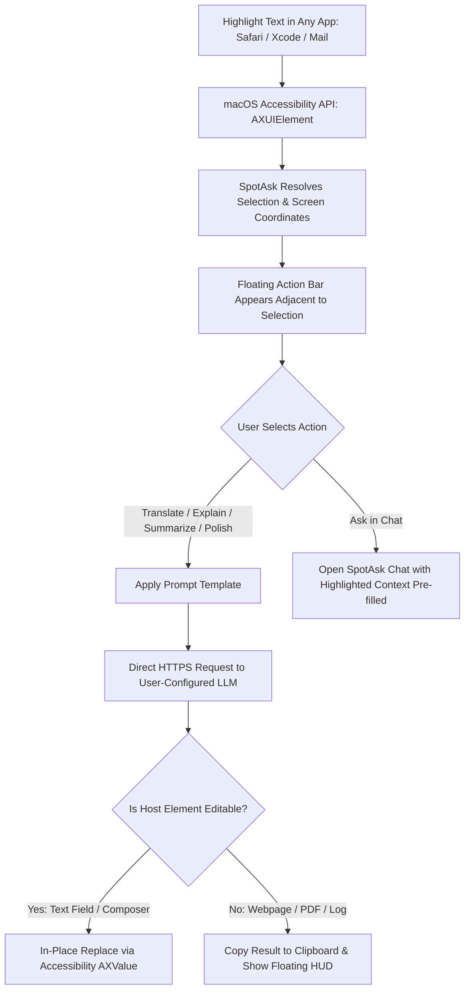

# Global Selection Assistant: In-Place AI Actions Across Any macOS App

SpotAsk Selection Assistant brings AI-powered text processing directly to where you work. Instead of copying text, switching windows, and pasting into a chat interface, you simply highlight text in any native macOS application—Safari, Xcode, Notes, Mail, Slack, or Terminal—and a lightweight floating action bar appears immediately beside your selection.

With a single click or keyboard shortcut, you can **Translate**, **Explain**, **Summarize**, **Polish**, or send the text to **Ask in Chat** for deep multi-turn follow-up.

## Quick Summary

- **In-place text actions**: Highlight text anywhere to immediately trigger floating quick actions next to your cursor.
- **Built-in prompt templates**: Instant one-click presets for **Translate**, **Explain**, **Summarize**, and **Polish**, plus full support for custom prompts.
- **In-place replacement**: In editable fields (such as Mail composers, Slack, or text editors), SpotAsk can replace your original draft with polished text in one keystroke.
- **Deep macOS Accessibility integration**: Works seamlessly across Safari, Xcode, Notes, Pages, Chrome, VS Code, and native macOS AppKit views.
- **Private & in-memory**: Selected text is processed strictly in-memory and sent directly to your configured LLM endpoint over TLS 1.3. Nothing is logged or retained.

## Install SpotAsk

Install via Homebrew:

```sh
brew tap shiquda/spotask https://github.com/shiquda/SpotAsk
brew install --cask shiquda/spotask/spotask
```

Or download the universal installer directly from [GitHub Releases](https://github.com/shiquda/SpotAsk/releases/latest):

- **Apple Silicon** (`arm64`): Download `SpotAsk-arm64.dmg`.
- **Intel Mac** (`x86_64`): Download `SpotAsk-x86_64.dmg`.

Signed with an Apple Developer ID certificate and notarized by Apple.

## The Problem: The 7-Step Friction of Copy-Paste Text Processing

When reading technical documentation, reviewing code pull requests, or drafting correspondence, interacting with text in another language or complex syntax is a constant requirement. Traditional workflows suffer from high friction:

1. **The 7-step shuffle**:
   - Highlight text.
   - Press <kbd>⌘ + C</kbd>.
   - Switch application spaces to a browser tab or desktop AI app.
   - Paste the text into an input box (<kbd>⌘ + V</kbd>).
   - Type prompt instructions (e.g., *"Translate this into English"* or *"Explain this error"*).
   - Wait and copy the generated output (<kbd>⌘ + C</kbd>).
   - Switch back to your original app and paste the result (<kbd>⌘ + V</kbd>).
2. **Cognitive flow disruption**: Repeated context switching shatters focus. Returning to an editor after navigating away requires re-reading surrounding lines to regain context.
3. **Clipboard pollution**: Copying fragments continuously pollutes system clipboard history and clipboard manager utilities.

## How SpotAsk Solves It: Native Accessibility Integration & In-Place Processing

SpotAsk eliminates the window-switching cycle by overlaying an intelligent action bar directly onto the macOS screen coordinates of your selection.



### Architectural Principles

- **Zero-Injection Accessibility (`AXUIElement`)**: SpotAsk does not inject dynamic libraries (`DYLD_INSERT_LIBRARIES`) or modify target application runtimes. It uses the official macOS Accessibility API to inspect focused UI elements and retrieve selected text attributes.
- **Accurate Screen Coordinate Positioning**: Reads the bounding rectangle of selected glyphs to position the floating HUD precisely below or above the highlighted line, avoiding obscuring the text being read.
- **Smart Replacement vs. Clipboard Routing**:
  - In editable text views (such as Mail, Notes, or Slack), actions like **Polish** or **Translate** can automatically replace the selected draft text in place.
  - In read-only views (such as Safari web pages, PDF readers, or Xcode compile logs), SpotAsk copies the result to your clipboard or displays it in an expandable floating popover.
- **Context Retention in Chat**: Selecting **Ask in Chat** opens the main SpotAsk window with the highlighted text automatically injected as context, allowing you to ask follow-up questions without manual copy-pasting.

## 3-Step Quick Start

### Step 1: Enable Selection Assistant & Grant Permission

1. Launch SpotAsk, open Settings (<kbd>⌘ + ,</kbd>), and select the **Selection** tab (or run `open "spotask://settings/selection"`).
2. Check **Enable Selection Assistant**.
3. When prompted, grant Accessibility permission in **System Settings > Privacy & Security > Accessibility**.

### Step 2: Highlight Text in Any Application

Open Safari, Xcode, Mail, or Notes, and select any word, phrase, or paragraph with your mouse or keyboard.

The SpotAsk floating action bar appears immediately beside your highlighted text.

### Step 3: Click an Action or Use a Shortcut

Click **Translate**, **Explain**, **Summarize**, or **Polish** (or press their assigned shortcuts). SpotAsk streams the result in real time.

## Visual Proof


*Figure 1: The Selection Assistant presents floating inline quick actions (Translate, Explain, Summarize, Polish, Ask in Chat) immediately beside highlighted text across macOS apps.*

## Technical Specifications & Verified Boundaries

| Parameter | Specification | Verification Evidence |
| :--- | :--- | :--- |
| **System API** | macOS Accessibility (`ApplicationServices.AXUIElement`) | Non-intrusive public API; zero process code injection |
| **Compatible Apps** | Safari, Xcode, Apple Notes, Mail, Slack, Pages, VS Code, Terminal | Verified across standard AppKit, WebKit, and Electron text inputs |
| **Action Modes** | Translate, Explain, Summarize, Polish, Custom Prompts, Ask in Chat | Fully customizable prompt templates in Settings > Prompts |
| **Output Behavior** | In-place text replacement (editable fields) / Clipboard copy (read-only) | Automatic detection via `kAXValueAttribute` writability check |
| **Memory Footprint** | < 25&nbsp;MB RSS during active selection tracking | Native Swift lightweight event loop |
| **Operating System** | macOS 15.0 or later | Universal binary (`arm64` & `x86_64`) |

### Known Limitations & Boundaries

- **Accessibility Authorization Required**: macOS requires explicit user permission in System Settings > Privacy & Security > Accessibility. SpotAsk cannot read selections if this permission is revoked.
- **Non-Standard Canvas Elements**: Web applications using custom HTML5 canvas rendering (such as Google Docs canvas mode or WebGL terminals) may not expose standard macOS Accessibility selection bounds.
- **Secure Password Fields**: Selection tracking is automatically disabled inside secure password fields (`NSSecureTextField`) by the macOS window server.

## Download SpotAsk

Streamline your text workflows across macOS today:

```sh
brew tap shiquda/spotask https://github.com/shiquda/SpotAsk
brew install --cask shiquda/spotask/spotask
```

Direct installer packages are available on [GitHub Releases](https://github.com/shiquda/SpotAsk/releases/latest).

### Explore Next

- [Selection Assistant In-Depth Guide](/guides/selection-assistant) — Trigger methods, custom prompts, and shortcut setup.
- [Prompts Configuration Guide](/guides/prompts) — Create custom templates for your daily tasks.
- [macOS AI Launcher](/use-cases/mac-ai-launcher) — Instant global hotkey summoning.
- [Zero-Telemetry Privacy Architecture](/use-cases/privacy-architecture) — How your data stays strictly local.
