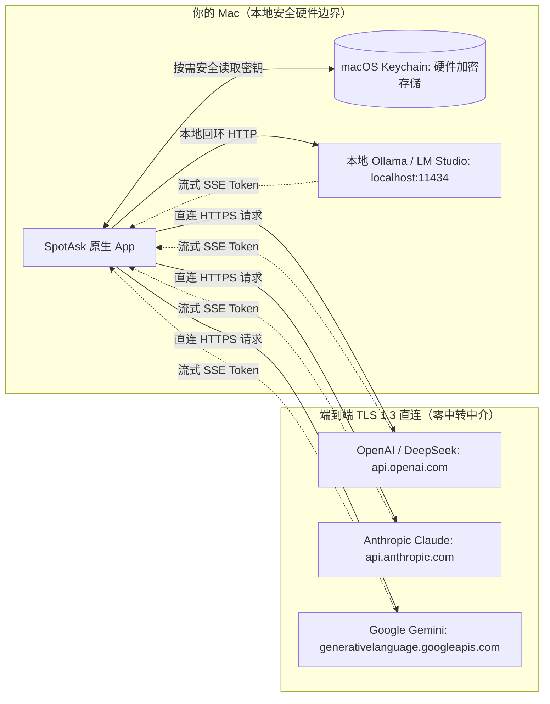

# BYOK 原生 macOS AI 客户端：自带 API Key 拒绝二次加价订阅

SpotAsk 是专为 Mac 用户打造的原生 Bring-Your-Own-Key（BYOK，自带密钥）AI 助手。

通过将你自己的 API Key 直接连接至 OpenAI、Anthropic、Google Gemini、DeepSeek、Groq、OpenRouter，或通过 Ollama 连接本地离线运行的开源大模型，SpotAsk 让你畅享全球顶尖模型的推理能力，彻底告别每月数十美元的固定软件加价订阅与商业云端数据中转。

你的所有密钥均加密存放于 macOS 系统 Keychain 中，每次提问均端到端直达模型提供商官方接口。

## 核心亮点

- **零二次加价，按需用量计费**：直接向模型提供商支付原始 Token 费用（日常轻量提问每月通常仅需几美分），拒绝每月 20–30 美元的固定 SaaS 溢价。
- **零中间商代理服务器**：所有网络请求均由你的 Mac 通过 TLS 1.3 直接发送至服务商。SpotAsk 没有中转代理服务器，无用户账号体系，零云端遥测。
- **Keychain 硬件级加密存储**：API 访问密钥通过 macOS Keychain Services（`kSecClassGenericPassword`）安全存储，受 Apple Secure Enclave 硬件安全模块加密保护。
- **多服务商聚合与快捷切换**：同时配置多个服务商（OpenAI、Anthropic Claude、Gemini、DeepSeek、Ollama），使用快捷键（<kbd>⌘ + 1</kbd> 至 <kbd>⌘ + 4</kbd>）在会话中随心切换模型。
- **离线本地大模型支持**：无缝对接运行在 `localhost:11434` 的本地 Ollama 或 LM Studio，断网状态下也能 100% 本地离线处理私密任务。

## 安装 SpotAsk

从 [GitHub Releases](https://github.com/shiquda/SpotAsk/releases/latest) 下载最新 DMG：

- **Apple Silicon**（M 系列芯片）：下载 `arm64` 安装包。
- **Intel Mac**（x86 芯片）：下载 `x86_64` 安装包。

官方发布包均通过 Apple Developer ID 签名并经 Apple 公证（`macOS 15+ · Apple Silicon / Intel · Native Swift`）。

也可以使用 Homebrew 安装：

```sh
brew tap shiquda/spotask https://github.com/shiquda/SpotAsk
brew install --cask shiquda/spotask/spotask
```

## 场景痛点：商业套壳软件的加价套路与云端安全隐患

市面上常见的桌面 AI 客户端普遍采用中心化 SaaS 模式，为用户带来了严重的经济负担与隐私隐患：

1. **3 倍至数十倍的订阅溢价陷阱**：商业套壳软件普遍收取每月 15–30 美元固定月费。如果用户每天仅进行数十次快速提问，使用高性价比模型（如 GPT-4o-mini、Claude 3.5 Haiku 或 DeepSeek-V3）的原始 Token 成本每月往往不足 1 美元。固定订阅让轻量用户为极简功能支付了数十倍的冤枉钱。
2. **中心化中转服务器泄密风险**：多数套壳应用要求将你的提问内容与 API Token 发送到他们的私有云端服务器中转。一旦中间商后端发生数据泄露、配置失误或员工违规审查，你的敏感代码片段、商业机密和个人隐私将面临巨大风险。
3. **人为制造的模型锁死与限频**：为了控制运营成本，闭源客户端往往人为限制上下文长度，限制每日提问次数，或仅提供少数几个经过裁剪的模型，用户无法第一时间体验行业最新的前沿模型。
4. **无法结合本地算力与离线模型**：商业工具通常无法对接 Mac 本地 Apple Silicon 芯片运行的 Ollama 或 LM Studio，在飞机、高铁等离线场景下彻底瘫痪。

## SpotAsk 架构解答：原生直连与本地 Keychain 安全架构

SpotAsk 摒弃中心化代理机制，采用完全去中心化的本地直连客户端架构。



### 核心架构原则

- **端到端直接网络通信**：每个请求直接通过系统原生 `URLSession` 与目标服务商域名建立 TLS 握手，不存在任何 `spotask.com/api` 中转层。网络行为完全公开透明，可使用 Proxyman、Wireshark 或 Charles 随时审计抓包。
- **macOS Keychain 深度整合**：密钥绝不以明文形式保存在任何 `.json`、`.plist` 或 SQLite 文件中。SpotAsk 仅在构造 HTTP 请求头时按需通过 `kSecClassGenericPassword` 从钥匙串中读取。
- **全格式接口协议支持**：
  - **OpenAI 兼容协议**：完美兼容 OpenAI、DeepSeek、Groq、Mistral、Together、OpenRouter、vLLM 与 Ollama。
  - **Anthropic Messages 协议**：原生适配 Claude 3.5 Sonnet、Claude 3.5 Haiku 等全系模型。
  - **Google Gemini REST 协议**：直接调用 Gemini 2.5 Flash 与 Gemini 1.5 Pro 官方端点。
- **完全离线本地模型支持**：原生支持 `http://localhost:11434/v1`（Ollama）或 `http://localhost:1234/v1`（LM Studio）。搭配本地模型使用时，网络完全隔绝，数据零出机。

## 3 步快速上手

### 第 1 步：打开服务设置

启动 SpotAsk，按 <kbd>⌘ + ,</kbd> 打开设置面板，点击“服务”标签页（或在终端运行 `open "spotask://settings/provider"`）。

### 第 2 步：配置你的服务商

1. 点击“添加服务”或选择内置服务模板。
2. 选择“接口格式”：**OpenAI**、**Anthropic** 或 **Gemini**。
3. 输入服务地址（例如 `https://api.openai.com/v1`、`https://api.deepseek.com/v1` 或 `http://localhost:11434/v1`）。
4. 输入你的 API 访问密钥（自动保存至 Keychain）。
5. 填入模型 ID（例如 `gpt-4o-mini`、`claude-3-5-haiku-20241022`、`deepseek-chat` 或 `llama3.2`）。
6. 点击“测试连接”，验证网络与授权无误。

### 第 3 步：快捷呼出提问，畅享原始成本

在任何界面按 <kbd>⌥ + Space</kbd> 呼出 SpotAsk。通过顶部模型选择器或按 <kbd>⌘ + 1</kbd> 至 <kbd>⌘ + 4</kbd> 自由切换模型，按回车实时接收流式回答。

## 视觉演示


*图 1：SpotAsk 浮动对话窗口支持在已配置的 BYOK 服务商与模型之间随时无缝切换。*

## 技术事实与边界说明

| 参数项 | 技术规格 | 验证事实与依据 |
| :--- | :--- | :--- |
| **支持的 API 协议** | OpenAI Chat Completions、Anthropic Messages API、Google Gemini REST API | 全面支持 Server-Sent Events（SSE）流式响应与工具调用 |
| **密钥保存机制** | macOS Keychain Services（`kSecClassGenericPassword`） | Apple Secure Enclave 硬件加密；默认排除在明文配置备份之外 |
| **传输层安全** | 原生 TLS 1.3 HTTPS (`URLSession`) | 强制现代密码套件；本地回环测试允许 `127.0.0.1` / `localhost` HTTP |
| **本地离线模型** | Ollama、LM Studio、vLLM、llama.cpp | 任何兼容 OpenAI 接口规范的本地回环服务均可直接接入 |
| **操作系统要求** | macOS 15.0 或更高版本 | Universal 通用二进制架构（`arm64` 与 `x86_64`） |
| **账号与许可绑定** | 无（零 SpotAsk 账号体系） | 纯客户端独立运行架构，无外部认证依赖 |

### 已知边界与限制

- **需自行准备模型服务商账号**：SpotAsk 作为 BYOK 客户端，不贩售也不代充 API 额度。你需要自行在 OpenAI、Anthropic、Google 申请 API Key，或在 Mac 本地安装 Ollama。
- **服务地址格式要求**：OpenAI 兼容服务区分为“服务根地址”（如 `https://api.openai.com/v1`）与“完整请求地址”（如 `https://api.openai.com/v1/chat/completions`）。请参考[服务根地址与完整请求地址指南](/zh-CN/guides/service-addresses)。
- **服务商限频与配额规则**：请求限频（RPM/TPM）与单日并发上限由你所购买的 API 官方服务商等级决定，SpotAsk 自身不设置任何频次限制。

## 立即下载 SpotAsk

体验自主可控、极速响应的原生 BYOK AI 客户端。

从 [GitHub Releases](https://github.com/shiquda/SpotAsk/releases/latest) 下载 `arm64` 或 `x86_64` 安装包，或使用[上方 Homebrew 命令](#安装-spotask)安装。

### 继续探索

- [连接 OpenAI 兼容服务指南](/zh-CN/guides/connect-openai-compatible) — OpenAI、DeepSeek、Groq 配置详解。
- [连接 Anthropic 指南](/zh-CN/guides/connect-anthropic) — 配置 Claude API 密钥与流式对话。
- [服务根地址与完整请求地址](/zh-CN/guides/service-addresses) — 掌握不同平台 URL 拼接规范。
- [本地优先与零遥测隐私架构](/zh-CN/use-cases/privacy-architecture) — 了解 SpotAsk 如何彻底捍卫本地数据隐私。
