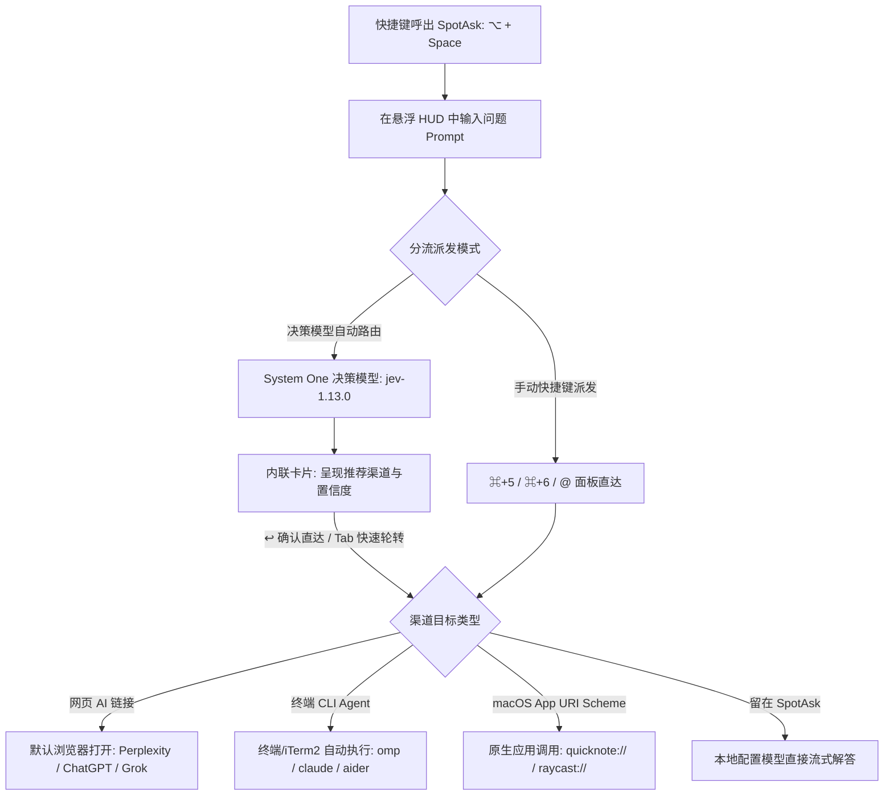

# External Ask 智能路由：从瞬间捕捉到多平台协同执行

SpotAsk External Ask（外部提问）带来了一种颠覆传统工作流的 AI 交互范式：**“先提问，再决定去哪。”**

传统的 AI 交互强制用户在动笔前先想清楚“该打开哪个软件”，而 SpotAsk 让一切回归直觉：无论何时灵感闪现，按下全局快捷键（默认 <kbd>⌥ + Space</kbd>）唤出纯净悬浮窗口，在思绪最新鲜的第一秒写下问题，随后一键或自动将任务分流给最适合的平台——无论是实时联网搜索（Perplexity、ChatGPT、Grok）、本地桌面应用（通过 URI Scheme），还是在终端自主执行复杂代码任务的本地 CLI Agent（`omp`、`claude`、`aider`）。

分流可以通过预设按钮、键盘独立快捷键直接派发，也可以交由内置的极速 System One 决策模型（如 `typesafe/jev-1.13`）在数百毫秒内完成意图研判并内联确认。

## 核心亮点

- **捕获与执行彻底解耦**：灵感初现即刻键入，彻底摆脱打开浏览器找标签页、开终端新建窗口的繁重仪式感。
- **双模极速分流体系**：
  - **手动一键与全键盘触发**：通过窗口内联按钮、顺序快捷键（<kbd>⌘ + 5</kbd>、<kbd>⌘ + 6</kbd>）或 `@` 快速检索指令面板秒级跳转。
  - **决策模型自动意图路由**：接入极速轻量 System One 决策模型，智能分析 Prompt 语义并推荐最佳渠道，内联浮层一键回车直达。
- **三大主流目标载体全覆盖**：
  - **网页端 Web AI**：支持携带 query 直达 Perplexity (`https://www.perplexity.ai/search?q={query}`)、ChatGPT、Grok 等。
  - **本地终端 CLI Agent**：直接调用并唤起已配置的命令行 Agent，如 `omp {query}`、`claude {query}` 或自定义自动化脚本。
  - **原生 macOS 桌面 App**：支持系统 URL Scheme 唤起，如 `quicknote://new?text={query}`、`cursor://`。
- **零额外 Token 浪费与零历史污染**：分流外派的问题不在应用内产生对话消耗，不占用多轮上下文 Token，也不污染应用内历史记录。
- **严密的数据隐私安全边界**：决策请求强制走 HTTPS；拦截非同源重定向；带有文件或图片附件的提问自动绕过外部路由留在本地。

## 安装 SpotAsk

从 [GitHub Releases](https://github.com/shiquda/SpotAsk/releases/latest) 下载最新 DMG：

- **Apple Silicon**（M 系列芯片）：下载 `arm64` 安装包。
- **Intel Mac**（x86 芯片）：下载 `x86_64` 安装包。

官方发布包均通过 Apple Developer ID 签名并经 Apple 公证（`macOS 15+ · Apple Silicon / Intel · Native Swift`）。

也可以使用 Homebrew 安装：

```sh
brew tap shiquda/spotask https://github.com/shiquda/SpotAsk
brew install --cask shiquda/spotask/spotask
```

## 场景痛点：多工具割裂时代的心流耗损

当下 AI 工具蓬勃发展，但没有任何单一平台能包揽所有任务：

1. **垂类专业工具的场景割裂**：
   - 快速查语法、概念解释，适合用轻量极速模型本地秒回。
   - 了解今天最新科技动态或行业研报，必须依赖带实时联网搜索的 Perplexity 或 Grok。
   - 涉及多文件重构、跑单测、修 Bug、Git 提交等重型工程，必须交由终端中的交互式 CLI Agent（`omp`、`claude-code`、`aider`）自主执行。
2. **提问前的决策阻滞与注意力分散**：每次有新想法，你都必须先在脑海中做一道选择题：“这个该去浏览器问，还是该开终端问？”当你切换桌面空间、找到窗口、等待前端加载并聚焦输入框时，原先的思考早已被严重打断。
3. **机械繁琐的跨端搬运复制**：在浏览器、IDE 和终端窗口之间频繁切换、复制粘贴 Prompt，既浪费操作时间，又造成系统剪贴板杂乱。

## SpotAsk 架构解答：统一捕获与智能双模分流

SpotAsk 将所有提问的入口统一收敛到单一键盘浮窗中，再由系统精准分流到目标执行环境。



### 核心架构亮点

- **一键快捷分流**：外部提问渠道在提问浮窗底部以按钮形式清晰排列，同时顺延分配应用内快捷键（如默认提示词占用了前几个键，第一和第二个外部渠道即为 <kbd>⌘ + 5</kbd> 和 <kbd>⌘ + 6</kbd>）。
- **System One 决策路由（Decision Routing）**：在“设置 > 外部提问”中开启自动路由后，SpotAsk 借助极速决策端点（如 `https://api.typesafe.ai` 或 OpenRouter 托管的 `typesafe/jev-1.13`），仅需 ~300&nbsp;ms 即可完成意图识别。提问框上方即刻弹出内联确认卡片，按 <kbd>↩</kbd> 确认放行，按 <kbd>Tab</kbd> 可快速循环切换备选渠道，按 <kbd>Esc</kbd> 取消并保留在本地。
- **会话工具栏一键暂停**：开启智能路由后，对话工具栏提供智能路由快捷图标（默认快捷键 <kbd>⌘ + ⇧ + R</kbd>），支持针对当前单个会话临时静默自动路由，新开对话时自动复位。
- **附件隐私安全熔断**：一旦问题中包含图片、PDF 或代码附件，SpotAsk 会自动熔断外部路由与决策模型，确保敏感文件资产 100% 留在应用内本地闭环处理。

## 3 步快速上手

### 第 1 步：打开外部提问设置

按下 <kbd>⌘ + ,</kbd> 打开 SpotAsk 设置面板，进入**外部提问**标签页（或在终端运行 `open "spotask://settings/external-ask"`）。

### 第 2 步：配置目标渠道与决策服务

1. 查看内置渠道（ChatGPT、Perplexity）或点击“添加”创建自定义渠道：
   - **网页问题**：`https://www.perplexity.ai/search?q={query}`
   - **终端命令**：`omp {query}` 或 `claude {query}`
   - **打开应用**：`quicknote://new?text={query}`
2. （可选）在**智能路由**下方勾选“启用自动路由”，填入服务地址（`https://api.typesafe.ai`）、模型 ID（`typesafe/jev-1.13`）与访问密钥。

### 第 3 步：全局呼出、键入并秒级分流

1. 在任意工作区按下 <kbd>⌥ + Space</kbd>。
2. 输入你的问题（例如：“*本周开源领域最新的几个关键突破*”或“*帮我重构这段 Swift 结构体使其支持并发安全*”）。
3. 直接按下 <kbd>⌘ + 5</kbd> 秒发 Perplexity，或者等待智能路由卡片出现后按下回车键 <kbd>↩</kbd> 直达最佳目标。

## 视觉演示

<video poster="/images/spotask-smart-routing-preview.gif" src="/videos/SpotAsk-smart-routing-v5.mp4" controls muted playsinline width="720"></video>

*视频：一个问题，三种去向——智能路由实机演示（28 秒）。[下载 / 观看高清视频 (1080p MP4)](/videos/SpotAsk-smart-routing-v5.mp4)*


*图 1：SpotAsk 将复杂代码重构问题直接一键分流并注入终端本地运行的 CLI Agent。*

## 技术事实与边界说明

| 参数项 | 技术规格 | 详细说明 |
| :--- | :--- | :--- |
| **支持的目标类型** | 网页 URL、macOS URI 协议、终端 Shell 命令、留在 SpotAsk | 使用 `{query}` 占位符，系统自动完成 URL 百分号编码或 Shell 转义 |
| **决策模型规范** | `typesafe/jev-1.13`、OpenRouter System One | 纯分类轻量模型，平均响应延迟 200–400&nbsp;ms |
| **网络通信与安全性** | 严格强制 TLS 1.3 HTTPS 通信 | 本地回环调试允许 `localhost`/`127.0.0.1` HTTP；拒绝跨源或降级至 HTTP 的重定向 |
| **终端执行环境** | 用户默认登录 Shell（`$SHELL`） | 自动调起系统默认 Terminal 或已配置的终端仿真器并注入命令 |
| **超时保护机制** | 0.5 秒至 5.0 秒可调（默认 2.0 秒） | 决策模型请求若网络超时，自动优雅降级为手动选择或本地回答 |
| **系统兼容性** | macOS 15.0 或更高版本 | Universal 通用二进制架构（`arm64` 与 `x86_64`） |

### 已知边界与限制

- **浏览器登录状态前置**：网页型渠道会在系统默认浏览器中打开指定链接。如需自动生成回答，浏览器需预先处于目标网站（如 ChatGPT、Perplexity 或 Grok）的登录有效态。
- **终端环境变量依赖**：终端命令在当前用户的登录 Shell 环境中运行。目标命令行工具（如 `omp`、`ollama`、`claude`）需已配置并存在于系统的 `$PATH` 路径中。
- **输入预填与自动提交机制**：网页型链接会将搜索词填入目标站点的输入框中。是否能在跳转后立即自动触发提交，取决于目标第三方网页是否支持参数自动触发（或可通过浏览器油猴脚本增强）。

## 立即下载 SpotAsk

让每一个闪现的提问都精准流转至最佳执行环境。

从 [GitHub Releases](https://github.com/shiquda/SpotAsk/releases/latest) 下载 `arm64` 或 `x86_64` 安装包，或使用[上方 Homebrew 命令](#安装-spotask)安装。

### 继续探索

- [External Ask 外部提问详尽指南](/zh-CN/guides/external-ask) — 深入了解自定义渠道语法、智能路由微调与自动化脚本。
- [macOS 全局 AI 启动器](/zh-CN/use-cases/mac-ai-launcher) — 全局快捷键极速呼出与全键盘交互。
- [BYOK 原生 macOS AI 客户端](/zh-CN/use-cases/byok-macos-ai) — 自带 API 密钥与零加价模型接入。
- [全局划词 AI 助手](/zh-CN/use-cases/selection-assistant) — 划词即刻翻译、润色、解释、总结。
