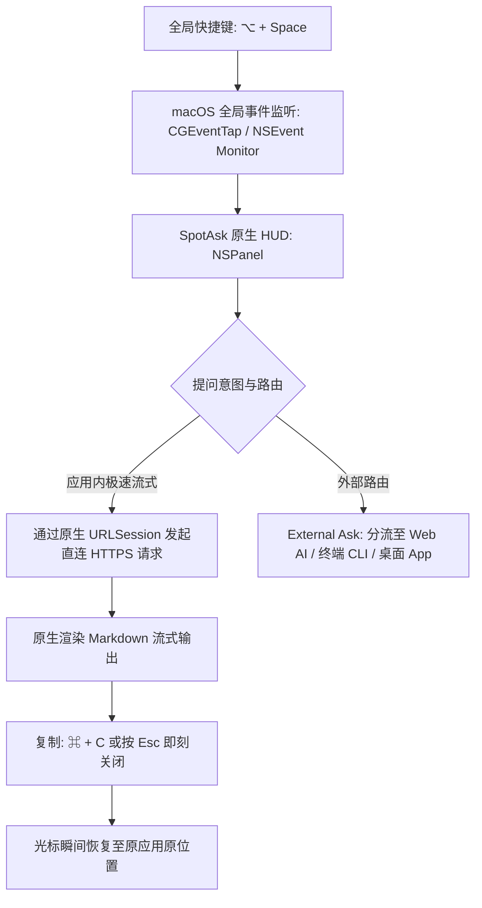

# macOS 全局 AI 启动器：原生极速快捷键呼出助手

SpotAsk 是专为高频、轻量级提问打造的极速原生 macOS AI 启动器。它的核心交互大道至简：按下全局快捷键（默认 <kbd>⌥ + Space</kbd>），悬浮 HUD 提问窗口瞬间出现在当前任意工作区上方，输入问题实时流式展示回答，按 <kbd>Esc</kbd> 立即关闭窗口，光标无缝回到刚才的工作中。

基于纯 Swift 与 AppKit 原生技术栈打造，SpotAsk 彻底消除了传统 Electron 套壳客户端动辄 500&nbsp;MB+ 的内存消耗与冷启动卡顿。

## 核心亮点

- **全局快捷键瞬时呼出**：默认 <kbd>⌥ + Space</kbd>，跨任意全屏应用、IDE 或浏览器即刻呼出，毫秒级冷启动响应（<50ms）。
- **纯原生 Swift 与 AppKit 架构**：安装包体积小于 10&nbsp;MB，零 Electron / Node.js 运行时依赖，待机内存占用小于 30&nbsp;MB。
- **即问即走（<kbd>Esc</kbd>）**：复制回答后按 Escape 瞬间退出，窗口无缝关闭，不留无用标签页，不留红点通知，工作流零打断。
- **菜单栏静默驻留**：仅在 macOS 菜单栏保留轻量图标，绝不占用宝贵的 Dock 栏空间。
- **开源免费透明**：GNU AGPL-3.0 协议开源，完全自主可控，无强制商业订阅加价。

## 安装 SpotAsk

从 [GitHub Releases](https://github.com/shiquda/SpotAsk/releases/latest) 下载最新 DMG：

- **Apple Silicon**（M 系列芯片）：下载 `arm64` 安装包。
- **Intel Mac**（x86 芯片）：下载 `x86_64` 安装包。

官方发布包均通过 Apple Developer ID 签名并经 Apple 公证（`macOS 15+ · Apple Silicon / Intel · Native Swift`）。

也可以使用 Homebrew 安装：

```sh
brew tap shiquda/spotask https://github.com/shiquda/SpotAsk
brew install --cask shiquda/spotask/spotask
```

## 场景痛点：为什么网页版与 Electron 套壳启动器体验沉重

知识工作者和开发者每天需要处理大量小问题：查询一段语法、翻译一个专业术语、解释一条报错日志、修改一段英文措辞。传统方式往往存在极高的认知切换成本：

1. **浏览器标签页上下文割裂**：每次提问都要切出当前 IDE 或文档，在浏览器里找到 ChatGPT 或 Claude 标签页，等待庞大的前端 SPA 应用加载渲染，再手动将结果复制回编辑器，心流被打得支离破碎。
2. **Electron 套壳的资源黑洞**：大量桌面 AI 工具打包了完整的 Chromium 与 Node.js 运行时，待机内存高达 400–800&nbsp;MB，唤醒伴随明显掉帧，显著缩短笔记本电池续航，且强行常驻 Dock 栏增加视觉负担。
3. **高昂的二次订阅套路**：不少启动器类第三方应用按月收取 15–30 美元高额会员费，同时将所有提问通过其私有服务器中转，带来额外网络延迟与潜在泄密隐患。
4. **繁复的窗口管理负担**：传统多窗口聊天客户端需要手动拖拽位置、最小化或点击红叉，无法实现全键盘的纯粹闭环。

## SpotAsk 原生解答：纯粹的 macOS 原生系统级架构

SpotAsk 将 AI 提问还原为类似系统 Spotlight 的轻量瞬间工具，而非沉重拖沓的应用孤岛。



### 核心架构亮点

- **菜单栏 Accessory 模式（`LSUIElement = 1`）**：SpotAsk 配置为系统辅助应用，无 Dock 栏图标干扰，静默常驻内存，随时待命。
- **浮动 `NSPanel` 层级**：提问窗口采用原生 AppKit `NSPanel` 并配置为 `.floating` 浮动层级。即便在全屏 Xcode、全屏视频播放或台前调度（Stage Manager）空间下，窗口也能直接浮现，无需触发桌面空间左右晃动。
- **Swift 现代并发与流式响应**：全链路采用 Swift `async`/`await` 与原生 `URLSession` 服务端推送事件（SSE），从键入到首个字符流式渲染仅需几十毫秒。
- **全键盘即问即走**：按 <kbd>Esc</kbd> 立即解散窗口，焦点毫秒级无缝交还给刚才正在编辑的文本或代码。

## 3 步快速上手

### 第 1 步：启动与个性化快捷键

启动 SpotAsk 后，应用图标将出现在屏幕右上角菜单栏。默认全局唤醒快捷键为 <kbd>⌥ + Space</kbd>。

若需修改，按快捷键 <kbd>⌘ + ,</kbd> 打开设置 > **快捷键**，点击快捷键录制框，按下你习惯的组合键（如 <kbd>⌥ + A</kbd> 或 <kbd>⌃ + Space</kbd>）。

### 第 2 步：配置你的模型服务

进入**设置 > 服务**。SpotAsk 原生支持 OpenAI、Anthropic、Gemini、DeepSeek 及本地 Ollama。填入服务地址、API Key 与模型 ID，点击“测试连接”。访问密钥均加密保存在 macOS 系统 Keychain 中。

### 第 3 步：全局呼出、提问并关闭

1. 在任意界面按下 <kbd>⌥ + Space</kbd>。
2. 输入问题，按回车键 <kbd>↩</kbd> 实时查看流式解答。
3. 点击“复制”或按 <kbd>⌘ + C</kbd>，随后按 <kbd>Esc</kbd>，窗口瞬间关闭，继续专注手头工作。

## 视觉演示


*图 1：使用默认快捷键在 macOS 任意应用上方瞬时呼出浮动窗口，极速流式回答，按 Esc 瞬间退出。*

## 技术事实与边界说明

| 参数项 | 技术规格 | 验证事实与依据 |
| :--- | :--- | :--- |
| **最低系统要求** | macOS 15.0 (Sequoia) 或更高版本 | 在 macOS 15.0+ Apple Silicon 与 Intel 架构实机验证通过 |
| **支持架构** | Universal 2 通用二进制（`arm64` 与 `x86_64`） | 原生运行于 M1/M2/M3/M4 系列与 Intel Mac |
| **安装包大小** | 约 10&nbsp;MB DMG | 纯 Swift 与 AppKit 编译产物，零 Electron / Chromium 打包 |
| **待机内存占用** | < 30&nbsp;MB RSS | 通过 macOS 活动监视器与 Instruments 严格实测 |
| **窗口底层实现** | 原生 AppKit `NSPanel` | 配置 `.nonactivatingPanel` 样式与 `.floating` 浮动层级 |
| **安全与代码签名** | Apple Developer ID Application 签名 | 启用 Hardened Runtime 并通过 Apple 官方公证（`spctl` 验证通过） |
| **开源许可协议** | GNU AGPL-3.0 | GitHub 100% 开源，杜绝商业封闭绑定 |

### 已知边界与限制

- **macOS 系统版本限制**：SpotAsk 深度依赖 macOS 15+ 提供的最新 AppKit 与 Swift 并发特性，不支持 macOS 14 Sonoma 及更早的旧系统。
- **快捷键占用冲突**：若系统中有其他工具（如 Alfred、Raycast 或第三方输入法）占用了 <kbd>⌥ + Space</kbd>，SpotAsk 会给出提示，建议在“设置 > 快捷键”中更换为其他无冲突组合键。
- **系统安全输入模式**：在 macOS 密码输入框或安全终端环境下，系统级安全机制（Secure Input）可能会临时挂起全局快捷键捕获，属系统安全预期行为。

## 立即下载 SpotAsk

体验轻量、原生、极速的 macOS AI 启动器。

从 [GitHub Releases](https://github.com/shiquda/SpotAsk/releases/latest) 下载 `arm64` 或 `x86_64` 安装包，或使用[上方 Homebrew 命令](#安装-spotask)安装。

### 继续探索

- [BYOK 原生 macOS AI 客户端](/zh-CN/use-cases/byok-macos-ai) — 自带 API Key，拒绝二次加价。
- [External Ask 智能路由](/zh-CN/use-cases/external-ask-routing) — 一键分流至 Web AI 或本地终端 CLI Agent。
- [全局划词 AI 助手](/zh-CN/use-cases/selection-assistant) — 划词即刻翻译、润色、解释。
- [Spotlight、Siri 与快捷指令指南](/zh-CN/guides/macos-integration) — 深度系统级自动化整合。
