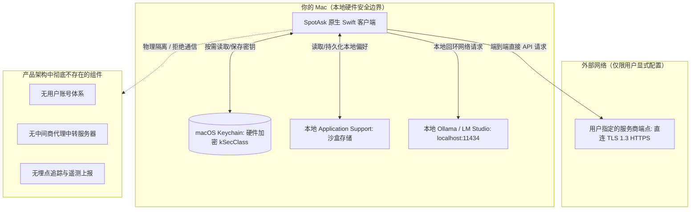

# 本地优先与零遥测隐私架构：无账号、无中转后端、零分析遥测

SpotAsk 从架构立项的第一天起，就将“本地优先（Local-First）与零遥测（Zero-Telemetry）”作为不可违背的核心设计基石。

整个客户端没有任何用户注册、登录、手机号或商业许可激活机制；完全没有搭建任何形式的云端中间商代理服务器；所有 API 访问凭据均加密存放在 macOS 系统 Keychain 中并受 Apple 硬件安全芯片保护；提问请求端到端直达你所配置的模型服务商端点；二进制代码中零嵌入任何商业分析埋点或行为追踪 SDK。

SpotAsk 100% 遵循 GNU AGPL-3.0 许可协议在 GitHub 公开源代码，随时接受全球开发者的独立安全与隐私审计。

## 核心亮点

- **100% 彻底无账号化**：无需注册，无邮箱验证，无任何用户标识符绑定。下载、解压、启动即可立刻投入使用。
- **零中间商代理服务器**：网络请求直接通过系统原生 TLS 1.3 发送给配置的模型接口（OpenAI、Anthropic、Gemini、DeepSeek 或本地 Ollama）。SpotAsk 没有任何私有中转服务器。
- **Keychain 硬件级加密存储**：API Key 仅存放于系统原生的钥匙串（Keychain Services，`kSecClassGenericPassword`），受 Apple Secure Enclave 硬件加密强力防护。
- **二进制代码零内嵌分析遥测**：不引入任何第三方埋点追踪库（无 Mixpanel、PostHog、Google Analytics、Sentry 等），不收集硬件指纹、IP 地址或提问元数据。
- **一键彻底抹除本地数据**：在“设置 > 通用”中点击“清除所有本地数据”，一键彻底销毁钥匙串密钥、本地设置与所有历史会话缓存。
- **开源 AGPL-3.0 协议保障**：每一行 Swift 网络请求与本地存储逻辑均在 GitHub 开源，杜绝任何“暗箱操作”。

## 安装 SpotAsk

从 [GitHub Releases](https://github.com/shiquda/SpotAsk/releases/latest) 下载最新 DMG：

- **Apple Silicon**（M 系列芯片）：下载 `arm64` 安装包。
- **Intel Mac**（x86 芯片）：下载 `x86_64` 安装包。

官方发布包均通过 Apple Developer ID 签名并经 Apple 公证（`macOS 15+ · Apple Silicon / Intel · Native Swift`）。

也可以使用 Homebrew 安装：

```sh
brew tap shiquda/spotask https://github.com/shiquda/SpotAsk
brew install --cask shiquda/spotask/spotask
```

## 场景痛点：商业套壳 AI 软件背后的隐私深渊

当下市面上的大部分商业闭源 AI 客户端，在架构设计上对用户隐私构成了巨大威胁：

1. **静默的埋点追踪与设备指纹捕获**：大部分桌面 AI 工具打包了商业分析 SDK，在后台悄悄收集提问频次、Prompt 字符长度、使用的模型、点击的菜单、甚至 Mac 硬件唯一 UUID 与局域网 IP 地址，用于构建用户画像。
2. **强制注册与真实身份关联**：商业软件强制要求用户绑定邮箱、手机号或信用卡才能使用本地客户端，将每一次工作中的私密提问与真实身份形成不可分割的数据链条。
3. **中间商服务器的截流风险**：套壳应用通常将提问、选中的代码及敏感商业文档上传至他们自建的中间服务器进行中转。一旦中间服务器存在安全漏洞、配置疏忽或员工越权审查，用户核心数字资产将面临泄露危机。
4. **闭源黑盒无法独立验证**：闭源应用无法被公开审计，用户根本无法证实软件后台是否在偷偷扫描本地剪贴板或收集非关联数据。

## SpotAsk 架构解答：可独立验证的本地优先与绝对透明

SpotAsk 从根本上剔除了中间服务器的概念，将安全防线牢固收敛在 Mac 本地硬件边界内。



### 核心隐私保证

- **彻底无账号体系**：SpotAsk 没有登录窗口、没有云端用户数据库、没有鉴权 Cookie。应用在你的 Mac 上自给自足。
- **端到端直连，拒绝中转**：SpotAsk 仅直接与 `api.openai.com`、`api.anthropic.com`、`generativelanguage.googleapis.com` 或你自定义的端点建立 TLS 1.3 加密通道。网络拓扑中不存在 `spotask.com/api` 中间人。
- **系统级 Keychain 硬件加密**：访问密钥受 Apple 硬件安全芯片保护，只在构造 HTTP 请求的瞬间按需调入内存，绝不以明文形式写入任何普通文件。
- **完全沙盒化的本地存储**：除钥匙串外，所有设置、自定义提示词与对话记录（若开启保存）全部存放在本机 `~/Library/Application Support/SpotAsk/`，绝不向外同步。
- **零分析埋点可实机验证**：你可以使用 Proxyman、Wireshark 或 Little Snitch 等专业抓包工具进行实时网络审查。你将观察到：在不发起提问时，SpotAsk 不会产生任何后台上报流量。
- **一键销毁本地痕迹**：进入“设置 > 通用”，点击“清除所有本地数据”，即可在毫秒级彻底清除钥匙串中的密钥、本地配置文件以及所有对话缓存。

## 3 步快速上手：自主验证与私密运行

### 第 1 步：安装并实测网络行为

安装 SpotAsk 后，打开任意网络流量监测工具（如 Little Snitch 或 Proxyman）。你会发现应用在后台没有任何多余的心跳或数据上报连接。

### 第 2 步：配置你的直连密钥或离线本地模型

打开设置（<kbd>⌘ + ,</kbd>）> **服务**：
- 输入你自己的 API Key（安全加密保存在钥匙串中）。
- 或者输入 `http://localhost:11434/v1` 连接本地 Ollama，实现 100% 断网状态下的真正物理离线运行。

### 第 3 步：安心提问与就地处理

使用 <kbd>⌥ + Space</kbd> 全局呼出提问，或跨软件选中文本执行翻译与润色，享有完全自主掌控的数据安全。

## 技术事实与边界说明

| 参数项 | 技术规格 | 详细说明与依据 |
| :--- | :--- | :--- |
| **用户账号系统** | 无（零账号） | 零注册、无身份识别、无邮箱收集 |
| **中间代理服务器** | 无（零中转） | 纯原生端到端直连网络架构 |
| **应用内埋点遥测** | 0 字节 | 二进制内无任何分析统计与追踪 SDK |
| **密钥加密标准** | macOS Keychain Services (`kSecClassGenericPassword`) | Apple Secure Enclave 硬件级加密防护 |
| **本地数据目录** | `~/Library/Application Support/SpotAsk/` | 本地沙盒化配置存储路径 |
| **开源许可协议** | GNU AGPL-3.0 | 100% 源码公开透明，支持独立安全审计 |
| **系统安全公证** | Apple Developer ID 官方签名 | 开启 Hardened Runtime 并通过 Apple Gatekeeper 扫描 |

### 已知边界与限制

- **第三方服务商隐私策略声明**：虽然 SpotAsk 本身不收集、不中转任何数据，但你配置的外部服务商（如 OpenAI、Anthropic 或 Google）会根据其各自的 API 开发者隐私与数据保留条款处理你的请求。如需实现彻底的物理级数据隔离，建议配合本地离线 Ollama 模型使用。
- **智能路由决策端点边界**：当在外部提问中启用决策模型自动路由时，问题文本与已启用的渠道候选名称描述会通过 HTTPS 发送至你配置的决策端点（如 TypeSafe 或 OpenRouter）进行分类。决策请求强制采用 HTTPS，且系统自动拦截非同源重定向。
- **自动更新检查机制**：应用内置的更新检查仅在启动时请求一次官方 GitHub Releases API，绝不上传任何提问、密钥或隐私数据。此项检查可在“关于 > 检查更新”中随时彻底关闭。

## 立即下载 SpotAsk

体验真正自主可控、零遥测的原生 macOS AI 助手。

从 [GitHub Releases](https://github.com/shiquda/SpotAsk/releases/latest) 下载 `arm64` 或 `x86_64` 安装包，或使用[上方 Homebrew 命令](#安装-spotask)安装。

### 继续探索

- [隐私与本地数据官方说明](/zh-CN/privacy) — 本地存储路径、数据清理与日志诊断详尽拆解。
- [BYOK 原生 macOS AI 客户端](/zh-CN/use-cases/byok-macos-ai) — 自带 API 密钥与零加价模型接入。
- [macOS 全局 AI 启动器](/zh-CN/use-cases/mac-ai-launcher) — 快捷键极速呼出与全键盘交互。
- [能力地图](/zh-CN/explore) — 全面掌握 SpotAsk 的系统级集成能力。
