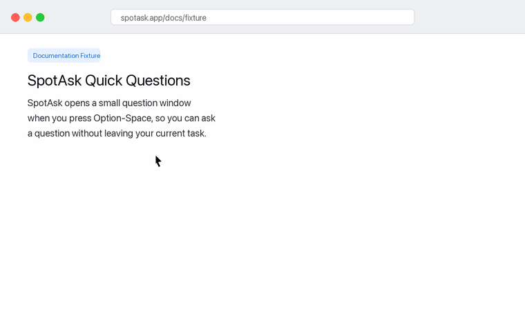
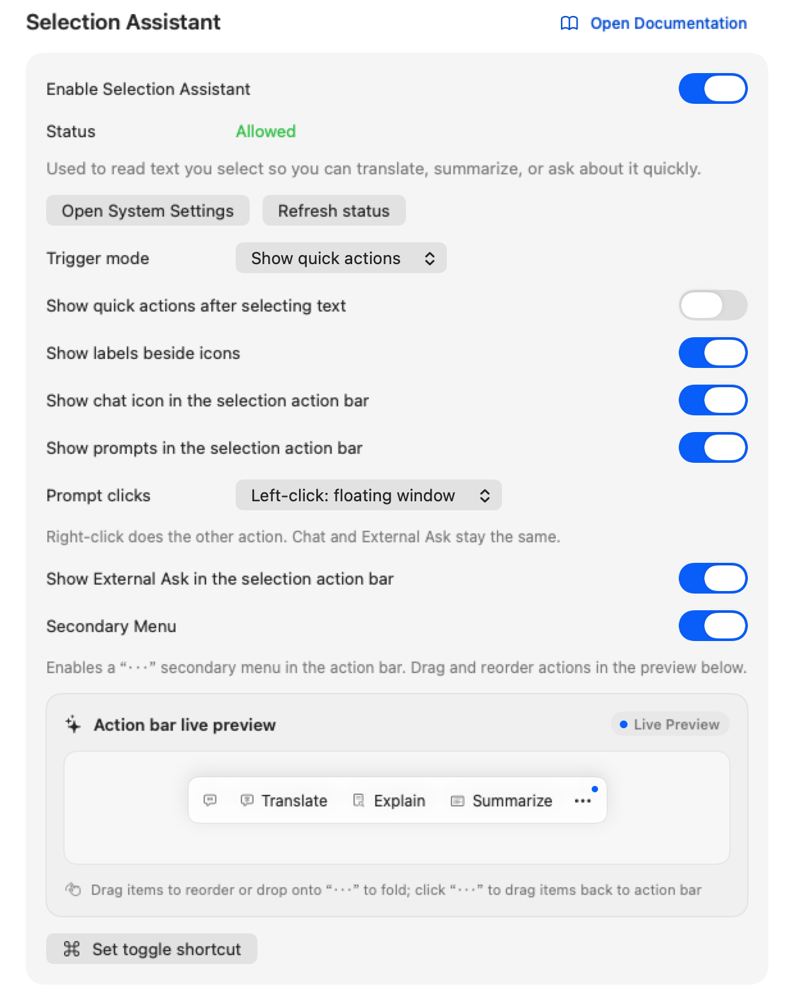
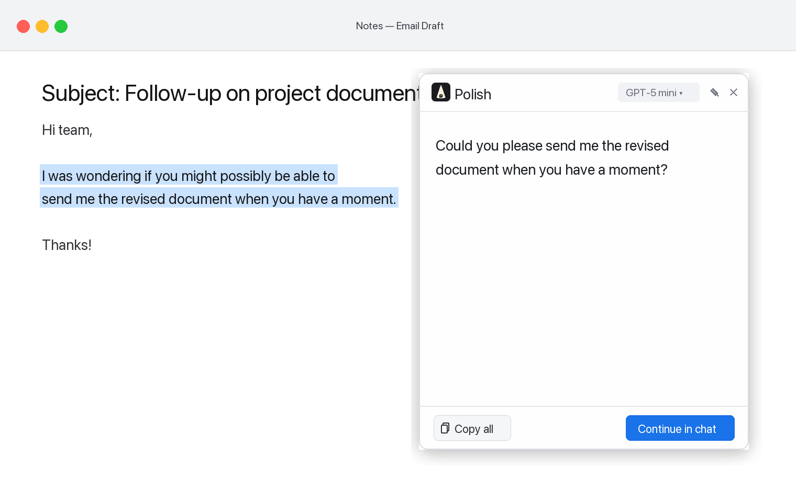

# 在任意 Mac 界面中划词翻译与改写，无需脱离当前应用

选中一段文字，点击快捷操作，继续专注手头工作。

无论是在 Safari 浏览技术资料、在“预览”中查阅 PDF 文档，还是在“邮件”与“备忘录”中撰写草稿，频繁在浏览器标签页、翻译网页或对话窗口之间来回复制粘贴都会打断思考流。SpotAsk 划词助手将 AI 翻译与改写能力直接下沉到你正在阅读或输入的界面中。

> **关于受支持的应用范围**：文中所指的跨应用与任意界面，限定于通过 macOS 辅助功能（Accessibility）规范暴露选中文本的应用程序（如 Safari、苹果备忘录、邮件、Xcode、终端等）。采用非标准自绘画布的应用需借助“剪贴板辅助划词”兼容，而系统密码框与安全凭据区域受操作系统保护，划词助手绝不介入。

---

## 划词翻译实操演示

以下是 Safari 中的典型阅读工作流：浏览一段包含产品专有名词与快捷键说明的英文说明，选中它，直接就地翻译。


*图 1：在 Safari 中高亮一段英文，快捷动作条随即在下方展开。点击“翻译”后，悬浮窗口在右侧呈现译文，原选区文本始终保持完整可见。*

### 输入与输出对照

| 阶段 | 实际内容 | 说明 |
| :--- | :--- | :--- |
| **原文（Safari）** | `SpotAsk opens a small question window when you press Option-Space, so you can ask a question without leaving your current task.` | 人工撰写的英文功能描述，包含快捷键与专有名词。 |
| **触发动作** | 左键点击动作条上的 **Translate（翻译）**（或按 `⌥ + ⇧ + Space`）。 | 将选区文本与翻译指令直接分发给已配置的 BYOK 模型。 |
| **译文（悬浮窗口）** | `当您按下 Option-Space 时，SpotAsk 会打开一个小提问窗口，因此您无需离开当前任务即可提出问题。` | 准确保留专有名词 `SpotAsk` 与快捷键写法 `Option-Space`，格式自然。 |
| **后续衔接** | 点击 **Copy all（全部复制）**（`⌘ + C`）或 **Continue in chat（在对话中继续）**。 | 译文写入剪贴板，当前工作窗口保持活跃。 |

---

## 亲自上手验证此流程

你可以在自己的 Mac 上按照以下步骤完整复现上述体验。

### 前置条件

1. **macOS 15.0（Sequoia）或更高版本**（支持 Apple Silicon 与 Intel 机型）。
2. **已安装 SpotAsk**：通过 [GitHub Releases](https://github.com/shiquda/SpotAsk/releases/latest) 下载 DMG，或使用 Homebrew 安装（`brew tap shiquda/spotask https://github.com/shiquda/SpotAsk && brew install --cask shiquda/spotask/spotask`）。
3. **已配置至少一个 AI 服务**：SpotAsk 不提供免费云端额度，处理请求需要模型端点。请参考 [BYOK 原生客户端使用指南](/zh-CN/use-cases/byok-macos-ai) 或 [兼容 OpenAI 协议服务接入](/zh-CN/guides/connect-openai-compatible) 添加你的 API 密钥。

### 详细配置步骤

1. **启用功能**：打开 **设置（`⌘ + ,`）> 划词助手**，开启“启用划词助手”。
2. **授予系统辅助功能权限**：根据 macOS 提示，打开 **系统设置 > 隐私与安全性 > 辅助功能**，勾选并允许 **SpotAsk**。SpotAsk 仅使用此权限获取屏幕上高亮文字的坐标与内容，绝不记录全屏画面或按键流。
3. **选择触发方式**：
   - **显示快捷操作**（推荐）：选中文本后在旁展现浮动操作条。可配置等待延时（默认 0.8 秒），或随时按下全局划词快捷键（`⌥ + ⇧ + Space`）即刻呼出。
   - **直接执行默认提示词**：选中后立即对内容触发指定动作（如直接翻译）。
4. **执行翻译**：在浏览器中选中上述英文例句，点击操作条上的 **Translate**。悬浮回答窗口随即展开在选区右侧，不会遮挡正在阅读的文字。
5. **复制结果**：点击窗口底部的 **Copy all**（或在悬浮窗口聚焦时直接按 `⌘ + C`），即可将译文复制至剪贴板。


*图 2：“设置 > 划词助手”界面，可自定义触发模式、延时、动作条按键排序与点击偏好。*

---

## 草稿润色：复制粘贴与就地替换的区别

阅读与写作在交互上下文上有本质区别：只读网页无法被直接修改，而在编辑器中草拟邮件时往往希望直接更新内容。SpotAsk 对这两种场景进行了明确区分。

### 在备忘录或邮件草稿中的实测示例

撰写英文邮件草稿时，如果写出了一句略显冗长的句子：

- **原草稿**：`I was wondering if you might possibly be able to send me the revised document when you have a moment.`
- **操作**：在备忘录或邮件草稿中选中该句，点击 **Polish（润色）**。
- **改写输出**：`Could you please send me the revised document when you have a moment?`


*图 3：在苹果备忘录中对选中文本进行 Polish 润色，悬浮窗口呈现更简明地道的表达。*

### 不同界面中的交付机制对比

| 界面类型 | 代表应用 | 支持的交互模式 | 详细流程与行为 |
| :--- | :--- | :--- | :--- |
| **只读文本界面** | Safari、Chrome、“预览” PDF、Xcode 文档 | **悬浮窗口 + 复制** | 文本节点在底层无法通过辅助功能接口被修改。回答呈现在独立悬浮窗口中，点击 **Copy all** 或按 `⌘ + C` 复制。 |
| **可编辑区域（悬浮模式）** | 苹果备忘录、“邮件”草稿、TextEdit、Slack | **悬浮窗口 + 复制粘贴** | 左键点击 Polish，结果在悬浮窗口中呈现。点击 **Copy all** 后在原草稿处按 `⌘ + V` 替换。按下 macOS 原生撤销快捷键（`⌘ + Z`）可即刻还原。 |
| **可编辑区域（主对话模式）** | 苹果备忘录、“邮件”编写器、原生文本输入框 | **就地替换插入（`arrow.down.doc`）** | 当把选区内容发送至主对话窗口（右键点击提示词按钮，或点击“在对话中追问”），AI 回复底部会显示 **“插入到选区”** 按钮。若目标应用焦点与选区范围未变，SpotAsk 会通过 `AXSelectedText` 直接覆盖替换原选区。 |

> **就地替换的安全门禁**：如果在 AI 生成期间你点击了其它应用或改变了文本选区范围，SpotAsk 会检测到选区不匹配并拒绝写入，弹出“选区已失效”提示，防止错误覆盖用户的其它文字。

---

## 30 秒验证基准

当 SpotAsk 与你的模型密钥配置完毕后，实际验证一次划词只需不到 30 秒：

1. 在 Safari 中打开任意文章或此页面。
2. 鼠标高亮选中一句英文。
3. 按下快捷键 `⌥ + ⇧ + Space`（或停顿 0.8 秒等待自动浮现）。
4. 点击 **Translate**，悬浮窗口在 1–2 秒内流式输出中文译文。
5. 按 `Esc` 键即刻关闭浮窗，或按 `⌘ + C` 复制译文继续阅读。

此 30 秒指环境就绪后的日常操作流速，首次安装与授权需前往系统设置完成一次性配置。

---

## 哪些情况下划词助手无法获取文字

SpotAsk 遵循 macOS 辅助功能的安全与架构规范，以下边界需特别留意：

- **系统安全密码框**：钥匙串密码框、1Password 等密码管理器以及终端中的 `sudo` 密码提示，操作系统会全面禁止辅助功能读取。SpotAsk 绝不且无法获取此类密码。
- **纯空白与未选中文本**：仅选中空格、制表符或换行符时，操作条不会触发。
- **缺乏无障碍节点的特殊画布应用**：部分软件（如 Zotero 内置 PDF 阅读器或自绘网页画布）以像素点阵渲染文字，未向 macOS 暴露 `AXSelectedTextRange` 节点。针对这类应用，可在 **设置 > 划词助手** 中勾选 **剪贴板辅助划词** 并添加该应用。触发动作时，SpotAsk 会执行一次标准系统复制抓取文字，并在读取后立即恢复你原有的剪贴板历史。该机制仅对白名单应用生效。
- **系统辅助功能权限被撤销**：若权限被关闭，应用无法获取屏幕选区坐标。SpotAsk 会在界面显示恢复指引，引导一键打开系统设置重新开启。

完整故障排除与配置详情请查阅 [划词助手排障指南](/zh-CN/troubleshooting)。

---

## 选中文本的数据去向与隐私设计

数据隔离与零遥测是 SpotAsk 的核心底线：

- **点对点直接传输**：只有你主动选中的文字和对应动作的提示词模板（如翻译或润色指令），会直接打包发往你在“服务”中设定的模型 API。
- **无中间代理服务器**：SpotAsk 没有自建的中间服务器，不收集任何分析遥测，也不抓取整个屏幕截图。数据通过加密 TLS 直接从你的 Mac 发往服务商（OpenAI、Anthropic、Google 等）。
- **本地模型全离线**：如果你将服务配置为本机运行的 Ollama（如 `http://localhost:11434/v1`），选中的所有文字将在本地完成推理，完全不经过公网。

深入了解本地架构请参考 [本地优先与零遥测隐私设计](/zh-CN/use-cases/privacy-architecture)。

---

## 针对不同场景选对合适工具

SpotAsk 在同一款轻量客户端中提供了针对不同任务维度的交互形态：

- **划词助手**（本页面工作流）：适合阅读与写作时的即时就地处理，借助当前屏幕已有上下文完成翻译、解释或润色。
- **全局呼出热键（`⌥ + Space`）**：适合独立提问、临时生成代码、快速头脑风暴。详见 [macOS 全局 AI 启动器](/zh-CN/use-cases/mac-ai-launcher)。
- **External Ask 外部路由**：适合当问题超出一问一答的快问范畴、需要交给网页端完整对话平台（ChatGPT、Claude、Grok）或终端本地 CLI Agent 深度执行的场景。详见 [External Ask 智能路由](/zh-CN/use-cases/external-ask-routing)。

---

## 下载 SpotAsk

SpotAsk 是完全免费且开源的 macOS 原生软件。前往 [GitHub Releases](https://github.com/shiquda/SpotAsk/releases/latest) 下载对应架构的 DMG（Apple Silicon 为 `arm64`，Intel 为 `x86_64`），或通过 Homebrew 安装：

```sh
brew tap shiquda/spotask https://github.com/shiquda/SpotAsk
brew install --cask shiquda/spotask/spotask
```

### 相关指南

- [划词助手使用指南](/zh-CN/guides/selection-assistant) — 触发模式、延时微调与按键定制。
- [BYOK 原生 macOS AI 客户端](/zh-CN/use-cases/byok-macos-ai) — 连接自己的 API Key 与模型。
- [提示词模板配置指南](/zh-CN/guides/prompts) — 自定义专属翻译与改写动作。
- [macOS 原生集成配置](/zh-CN/guides/macos-integration) — 深入了解辅助功能权限与系统快捷键。
- [疑难排查指南](/zh-CN/troubleshooting) — 解决权限、快捷键冲突与服务连接问题。
