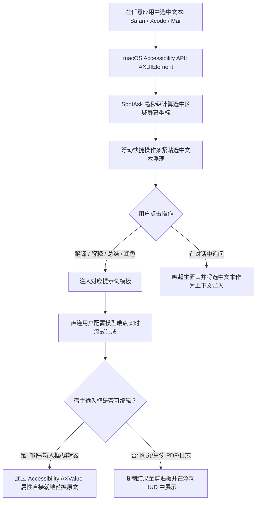

# 全局划词 AI 助手：跨任意 macOS 应用的就地就近文本处理

SpotAsk 划词助手将 AI 文本处理能力直接送达你正在阅读或撰写文字的第一现场。

你不再需要复制一段话、切出当前软件、打开网页或聊天窗口粘贴，再把答案复制回来。无论你是在 Safari 浏览外文技术文档、在 Xcode 研读报错日志与源码、在“备忘录”中沉淀思考，还是在“邮件”与 Slack 中草拟重要回复，只需选中文字，灵动轻巧的浮动操作条便会瞬时呈现在选中区域旁边。

轻轻一点或敲击对应快捷键，即可就地完成**翻译**、**解释**、**总结**、**润色**，甚至在可编辑文本框内直接将原文就地替换，让整个文本处理工作流一气呵成。

## 核心亮点

- **就地就近实时响应**：在任意应用中选中文本，操作面板紧贴光标浮现，无需切换窗口。
- **开箱即用的高频模板**：内置**翻译**、**解释**、**总结**、**润色**等经典提示词模板，并支持在设置中自定义专属 Prompt。
- **支持可编辑区域就地替换**：在邮件编写器、Slack 输入框或 Markdown 编辑器中，润色后的文字可一键直接替换当前选中的草稿。
- **深度系统级辅助功能集成**：广泛适配 Safari、Xcode、备忘录、Pages、Chrome、VS Code 等主流原生及第三方 macOS 软件。
- **纯内存处理与数据私密**：选中文字仅保存在内存中，直接通过 TLS 1.3 发送给用户自选的模型端点，本地绝不落盘，第三方绝不留存。

## 安装 SpotAsk

从 [GitHub Releases](https://github.com/shiquda/SpotAsk/releases/latest) 下载最新 DMG：

- **Apple Silicon**（M 系列芯片）：下载 `arm64` 安装包。
- **Intel Mac**（x86 芯片）：下载 `x86_64` 安装包。

官方发布包均通过 Apple Developer ID 签名并经 Apple 公证（`macOS 15+ · Apple Silicon / Intel · Native Swift`）。

也可以使用 Homebrew 安装：

```sh
brew tap shiquda/spotask https://github.com/shiquda/SpotAsk
brew install --cask shiquda/spotask/spotask
```

## 场景痛点：传统跨应用复制粘贴的“七步泥潭”

在日常阅读外文文献、审查工程代码或编辑商务沟通时，处理非母语或复杂文本是极高频的需求。传统的人工处理方式存在繁琐的摩擦：

1. **跨窗口折腾的“七步死循环”**：
   - 用光标选中文本。
   - 按 <kbd>⌘ + C</kbd> 复制。
   - 切换桌面空间或应用窗口，找到浏览器或 AI 客户端。
   - 找到输入框按 <kbd>⌘ + V</kbd> 粘贴。
   - 敲键盘补上要求（如：“*翻译成中文*”或“*帮我重写得更地道一些*”）。
   - 等待生成完毕后按 <kbd>⌘ + C</kbd> 复制答案。
   - 再次切回原软件，定位光标按 <kbd>⌘ + V</kbd> 粘贴覆盖。
2. **严重的认知心流撕裂**：频繁在多个不同视觉层级的窗口间往返跳跃，每次切回原文档都需要重新寻找上一行的阅读上下文，深度思考被打断。
3. **系统剪贴板持续污染**：大量临时的翻译碎片挤占了系统剪贴板，导致剪贴板历史工具混乱不堪。

## SpotAsk 架构解答：原生辅助功能驱动的就地就近处理

SpotAsk 彻底跳出“切换窗口”的陈旧思路，利用 macOS 原生辅助功能，将操作面板精准叠加在文字的屏幕坐标旁。



### 核心架构亮点

- **零代码注入的官方标准 API（`AXUIElement`）**：SpotAsk 绝不使用可能引发系统闪退或破坏沙盒的安全高危手段（如 `DYLD_INSERT_LIBRARIES` 注入）。它完全基于 Apple 官方提供的 Accessibility 辅助功能 API 监听聚焦元素与文本范围。
- **精准的屏幕坐标定位计算**：通过读取选中字形外接矩形（Bounding Box），浮动条可智能吸附在选中区域的正下方或正上方，绝不遮挡你当前正在审阅的文字内容。
- **智能就地替换与剪贴板兜底**：
  - 在可写文本框（如邮件正文、Slack、Notes）中，执行“润色”或“翻译”后，可配置直接就地替换原文本，瞬间完成措辞升级。
  - 在只读视窗（如 Safari 网页、PDF 预览、控制台日志）中，回答会自动复制至剪贴板，或在精简的浮层弹窗中供你查阅。
- **平滑引入多轮对话**：遇到疑难代码段时，点击“在对话中追问”，SpotAsk 会自动展开完整对话窗口，并将刚才选中的代码块作为上下文自动预填，随时发起深入探讨。

## 3 步快速上手

### 第 1 步：开启划词助手并授权系统辅助功能

1. 启动 SpotAsk，按 <kbd>⌘ + ,</kbd> 打开设置面板，进入**划词**标签页（或在终端运行 `open "spotask://settings/selection"`）。
2. 勾选“启用划词助手”。
3. 按照系统提示，在 **macOS 系统设置 > 隐私与安全性 > 辅助功能** 中允许 SpotAsk。

### 第 2 步：在任意软件中选中文本

打开 Safari、Xcode、备忘录或邮件，使用鼠标或键盘高亮任意一段文字、代码或词句。

SpotAsk 浮动操作条将即刻跟随在选中文本附近。

### 第 3 步：点击动作或键入快捷键

点击浮动条上的**翻译**、**解释**、**总结**或**润色**，SpotAsk 即刻在本地流式输出处理结果。

## 视觉演示


*图 1：划词助手在 macOS 跨应用高亮文字旁边即刻展示浮动操作条（翻译、解释、总结、润色、在对话中追问）。*

## 技术事实与边界说明

| 参数项 | 技术规格 | 验证事实与依据 |
| :--- | :--- | :--- |
| **底层系统 API** | macOS Accessibility（`ApplicationServices.AXUIElement`） | 无需注入进程代码，纯非侵入式公有 API |
| **适配软件范围** | Safari、Xcode、Apple 备忘录、邮件、Slack、Pages、VS Code、终端 | 经主流 AppKit、WebKit 及 Chromium 文本视图深度实测 |
| **核心内置动作** | 翻译、解释、总结、润色、自定义提示词、在对话中追问 | 提示词模板可在“设置 > 提示词”中自由扩展定制 |
| **输出行为表现** | 可编辑框支持直接就地替换；只读文本自动复制或浮层展示 | 基于 `kAXValueAttribute` 是否可写属性做自动化运行时判断 |
| **活跃内存占用** | 划词跟踪常驻状态下 < 25&nbsp;MB RSS | 纯 Swift 极速事件循环，无额外后台常驻守护进程 |
| **系统兼容要求** | macOS 15.0 或更高版本 | Universal 通用二进制架构（`arm64` 与 `x86_64`） |

### 已知边界与限制

- **必须授予 macOS 辅助功能权限**：根据 macOS 系统级安全策略，必须在“系统设置 > 隐私与安全性 > 辅助功能”中明确授权。若权限被撤销，划词助手无法捕获选中文字。
- **非标准 Canvas 绘制元素限制**：采用自绘引擎且未向操作系统暴露 Accessibility 节点的特殊软件（例如 Google Docs 的 Canvas 渲染模式或 WebGL 终端），可能无法准确汇报光标坐标。
- **安全密码输入框隔离**：在系统密码输入框（`NSSecureTextField`）中，macOS 系统会自动切断划词事件监听以防密码泄露。

## 立即下载 SpotAsk

体验无缝流畅的跨应用划词 AI 处理。

从 [GitHub Releases](https://github.com/shiquda/SpotAsk/releases/latest) 下载 `arm64` 或 `x86_64` 安装包，或使用[上方 Homebrew 命令](#安装-spotask)安装。

### 继续探索

- [划词助手深度使用指南](/zh-CN/guides/selection-assistant) — 详细了解触发模式、自定义提示词与高级快捷键。
- [提示词模板配置指南](/zh-CN/guides/prompts) — 打造属于你的高频定制文本工作流。
- [macOS 全局 AI 启动器](/zh-CN/use-cases/mac-ai-launcher) — 快捷键极速呼出对话。
- [本地优先与零遥测隐私架构](/zh-CN/use-cases/privacy-architecture) — 了解文本数据如何实现真正的零外传。
